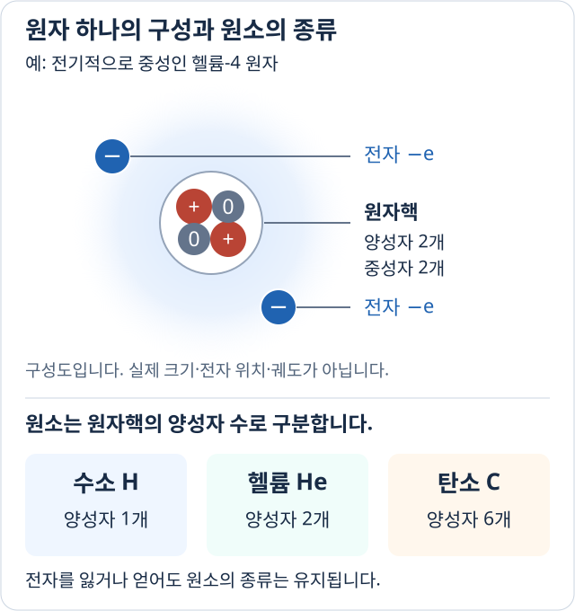
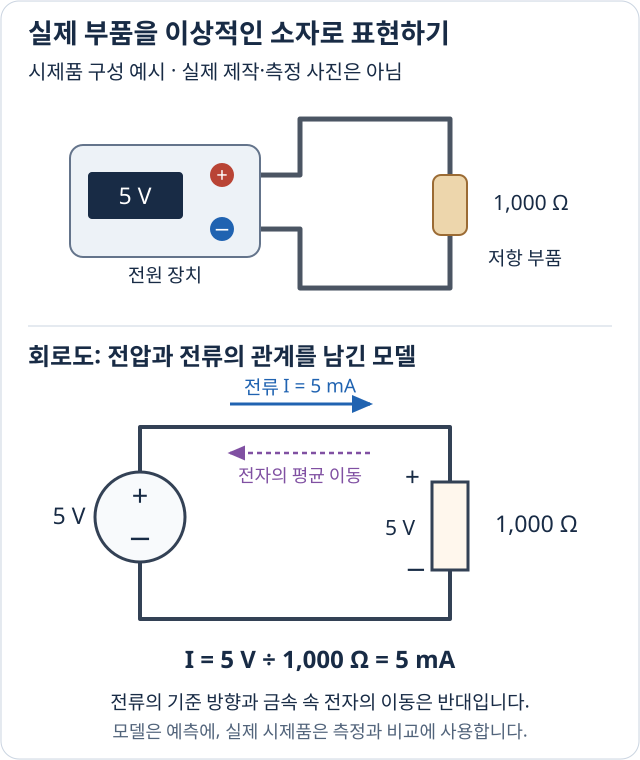
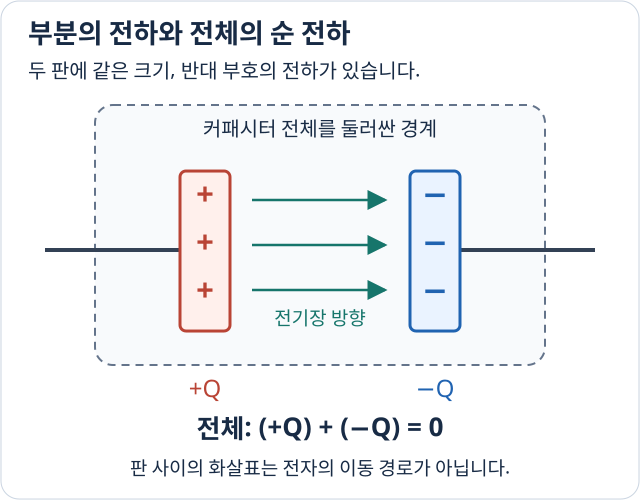
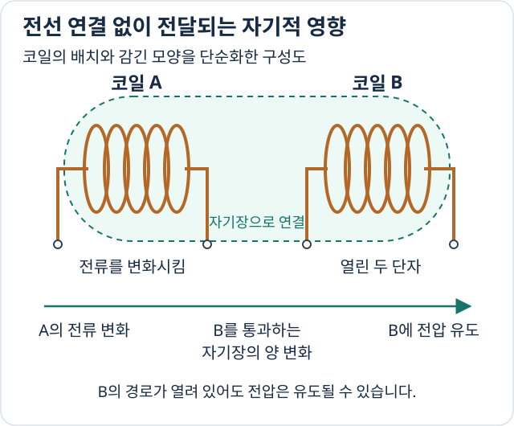
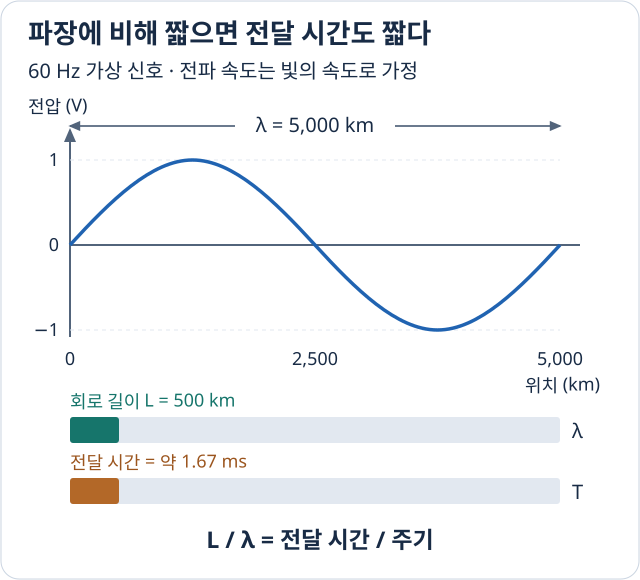

# 회로 변수 개요

전원에 전선을 연결하면 전류가 흐릅니다. 그런데 전선 안에서는 무엇이 움직일까요? 전원에 적힌 ‘5 V’는 무엇을 뜻하고, 실제 부품을 종이 위의 기호 몇 개로 바꾸어도 계산이 되는 이유는 무엇일까요?

이 질문을 따라가면 회로 이론에서 사용하는 말들이 연결됩니다. 먼저 전선을 이루는 물질을 살펴보고, 전류와 전압을 구분한 다음, 간단한 회로 하나를 계산해 보겠습니다. 그 계산이 현실에서 언제 유효한지도 함께 생각합니다.

## 전선 안에서는 무엇이 움직일까

구리 전선은 많은 **원자(atom)**로 이루어져 있습니다. 원자는 물질을 이루는 아주 작은 구성 단위입니다. 원자도 더 작은 입자로 이루어져 있는데, 중심에는 **원자핵**이 있고 그 주변에 **전자(electron)**가 분포합니다. 원자핵에는 **양성자**와 **중성자**가 있습니다. 가장 흔한 수소 원자는 예외적으로 중성자가 없습니다.

구리 금속에서는 일부 전자가 특정 원자 하나에만 묶이지 않고 금속 내부를 이동할 수 있습니다. 이 전자들이 전선에서 전하를 운반합니다. 전류가 흐른다고 해서 구리 원자 전체가 전선을 따라 이동하는 것은 아닙니다.

여기서 **원소(element)**는 원자의 *종류*를 뜻합니다. 종류를 결정하는 것은 원자핵의 양성자 수입니다. 양성자가 1개면 수소, 2개면 헬륨, 6개면 탄소, 29개면 구리입니다. 따라서 ‘구리 원자 하나’는 개별 원자이고, ‘구리라는 원소’는 양성자가 29개인 원자의 종류입니다.

원자가 결합해 하나의 독립된 단위를 이루면 **분자(molecule)**라고 부릅니다. 물 분자는 수소 원자 2개와 산소 원자 1개가 결합한 것이므로 물 자체가 원소인 것은 아닙니다. 다만 구리 금속을 물처럼 독립된 분자들의 모임으로 나누지는 않습니다.

## 전자가 움직이는 것이 왜 전기 현상일까

전자와 양성자에는 **전하(electric charge)**라는 성질이 있습니다. 전하는 입자가 전기적으로 서로 끌어당기거나 밀어내는 작용에 어떻게 참여하는지를 나타냅니다. 전자는 음전하, 양성자는 양전하를 가지며, 중성자의 전하는 0입니다. 정지한 전하를 비교하면 같은 부호끼리는 밀어내고 반대 부호끼리는 끌어당깁니다.

양성자 하나와 전자 하나의 전하 크기는 같습니다. 그 크기를 $e$라고 쓰면 각각 $+e$, $-e$입니다. 그래서 양성자와 전자의 수가 같으면 전하를 모두 더한 값은 0이 됩니다. **전하를 가진 입자가 있어도 전체는 전기적으로 중성일 수 있습니다.**

아래 그림에서 원자핵 안의 `+`는 양성자, `0`은 중성자, 바깥의 `−`는 전자입니다. 양성자와 전자가 각각 2개이므로 전하의 합은 $2e-2e=0$입니다.

*위는 헬륨 원자 하나의 구성이고, 아래는 원소의 종류를 비교한 것입니다. 전자 점은 개수를 나타내며 실제 위치·궤도·크기를 그린 것이 아닙니다. 헬륨-4의 4는 이 원자의 양성자와 중성자 수를 더한 값입니다.*

이렇게 **정해 놓은 범위 안의 전하를 부호까지 포함해 더한 값**을 **순 전하(net charge)**라고 합니다. 그림의 원자가 전자 하나를 잃으면 $2e-e=+e$가 됩니다. 양성자가 늘지 않아도 음전하가 줄었기 때문에 양전하를 띠는 것입니다. 양성자는 여전히 2개이므로 원소는 헬륨 그대로입니다. 전자를 잃거나 얻어 전하를 띤 원자는 **이온(ion)**이라고 합니다.

## 전류는 얼마나 많이 지나가는지를 나타낸다

전자 하나가 이동하면 그 전자가 가진 전하도 함께 이동합니다. 회로를 계산할 때는 전자 하나하나의 위치보다 **전선의 한 단면을 통해 전하가 얼마나 빠르게 이동하는지**가 필요합니다. 이것이 **전류(electric current)**입니다.

전하량의 단위는 **쿨롬(C)**입니다. 전자 하나의 전하 크기는 약 $1.602\times10^{-19}\,\mathrm{C}$이므로, 일상적인 회로의 전류에는 매우 많은 전자가 관여합니다. 전류의 단위인 **암페어(A)**는 초당 통과하는 전하량을 나타냅니다.

예를 들어 정한 방향으로 2초 동안 순 전하 4 C가 통과했다면, 평균적으로 초당 2 C가 지나갔으므로 전류는 2 A입니다.

$$
\text{평균 전류}=\frac{\text{통과한 순 전하량}}{\text{걸린 시간}},\qquad
1\,\mathrm{A}=1\,\mathrm{C/s}.
$$

이때 전류의 방향은 **양전하가 이동하는 방향을 기준**으로 정합니다. 따라서 금속에서 음전하인 전자가 오른쪽으로 이동하면 관습적인 전류 방향은 왼쪽입니다. 같은 현상을 서로 다른 기준으로 표현하는 것이므로 모순이 아닙니다.

## 전압은 전류와 무엇이 다를까

전류만으로는 전하가 이동하면서 에너지를 얼마나 전달하는지 알 수 없습니다. 같은 양의 전하가 이동해도 전원과 부품의 상태에 따라 전달되는 에너지가 달라집니다. 그래서 **전하량뿐 아니라 전하당 에너지도** 살펴봐야 합니다.

에너지는 운동이나 열 등의 형태로 전달·변환되는 물리량이며 단위는 **줄(J)**입니다. 전하도 다른 전하와의 배치, 위치에 따라 에너지가 달라집니다. 이를 **전기적 위치 에너지**라고 합니다. 전하의 배치가 시간에 따라 바뀌지 않는 상황에서, 두 지점 사이의 **전기적 위치 에너지 차이를 전하량으로 나눈 값**이 **전압(voltage)**입니다. 단위는 **볼트(V)**입니다.

예를 들어 A가 B보다 3 V 높다면, 양전하 1 C가 A에 있을 때의 전기적 위치 에너지가 B에 있을 때보다 3 J 높다는 뜻입니다. 양전하가 A에서 B로 이동할 때 이 에너지 차이가 다른 형태로 전환될 수 있습니다. 3 V라는 숫자만으로는 매초 얼마의 전하가 지나가는지, 즉 전류까지 알 수 없습니다.

| 알고 싶은 것 | 살펴볼 양 |
| --- | --- |
| 전하가 단위 시간당 얼마나 이동하는가? | 전류: 1 A는 초당 1 C |
| 두 지점 사이에서 전하당 에너지가 얼마나 다른가? | 전압: 1 V는 전하 1 C당 1 J의 차이 |

전압은 항상 **두 지점을 비교**합니다. ‘A가 B보다 3 V 높다’와 ‘B가 A보다 3 V 낮다’는 같은 상태입니다. 기준 지점에 대한 전하당 위치 에너지를 **전위(electric potential)**라고 하므로, 전압을 ‘전위 차’라고도 부릅니다. 자기장이 변해 생기는 전압은 뒤에서 따로 연결하겠습니다.

## 실제 부품을 어떻게 계산 가능한 회로로 바꿀까

이제 5 V 전원과 저항 부품 하나를 전선으로 연결한다고 생각해 봅시다. **저항(resistor)**은 전류가 흐를 때 전기 에너지를 열로 바꾸는 부품입니다. 같은 전압에서 전류가 얼마나 흐르는지를 나타내는 값이 **저항값**이고 단위는 **옴($\Omega$)**입니다. 저항값이 클수록 같은 전압에서 흐르는 전류가 작습니다.

실제 부품의 재료, 온도, 모든 전자의 움직임을 전부 계산하는 대신 우선 다음처럼 약속합니다.

- 전원은 연결한 회로에 상관없이 두 연결점 사이의 전압을 정확히 5 V로 유지한다.
- 저항값은 정확히 $1{,}000\,\Omega$이고, 온도 등에 따라 변하지 않는다.
- 전선에서 생기는 전압 차와 신호 전달 지연은 무시한다.

부품의 연결점을 **단자(terminal)**라고 합니다. 첫 번째 약속을 나타내는 소자는 **이상적인 전압원**, 두 번째 약속을 나타내는 소자는 **이상적인 선형 저항**입니다. ‘선형’은 여기서 전압을 두 배로 하면 전류도 두 배가 되는 비례 관계를 뜻합니다.

이처럼 필요한 관계만 남긴 계산 대상을 **이상적인 회로 소자(ideal circuit element)**라고 합니다. **‘이상적’은 실제로 완벽한 부품이 있다는 말이 아니라, 어떤 성질을 정확히 따른다고 약속한 모델이라는 뜻**입니다. 소자는 모델의 구성 단위이고, **모델**은 실제 대상에서 관심 있는 성질을 골라 표현한 것입니다.

## 문제 예시: 5 V 전원에 저항 하나를 연결하면

이상적인 5 V 전원과 $1{,}000\,\Omega$ 저항을 전선으로 연결하여, 전원에서 저항을 거쳐 다시 전원으로 돌아오는 닫힌 경로를 만들었습니다. 저항에 흐르는 전류는 얼마일까요?

**풀이.** 전선에서 전압 차가 생기지 않는다고 했으므로 저항 양 끝에도 5 V가 걸립니다. 이 저항 모델에서는 **전류 = 전압 ÷ 저항값**입니다. 따라서 다음과 같이 계산합니다.

$$
I=\frac{V}{R}=\frac{5\,\mathrm{V}}{1{,}000\,\Omega}
=0.005\,\mathrm{A}=5\,\mathrm{mA}.
$$

$I$는 전류, $V$는 저항 양 끝의 전압, $R$은 저항값입니다. 밀리암페어(mA)는 A의 1,000분의 1입니다. 이 관계를 $V=IR$로 쓴 것이 **옴의 법칙**입니다. 지금처럼 일정한 저항값으로 비례 관계를 나타낼 수 있는 소자에 적용합니다.

그림에서 파란 화살표는 계산에 사용한 전류 방향입니다. 저항 위쪽을 `+`, 아래쪽을 `−`로 잡았으므로 전류는 저항을 위에서 아래로 흐릅니다. 점선 화살표는 위쪽 금속 전선에서 전자의 평균 이동 방향을 나타냅니다.

*위는 시제품을 가정한 구성 그림이며 실제 제작 사진이 아닙니다. 아래는 계산에 사용한 모델입니다. 원 안의 +와 −는 전압원, 오른쪽 직사각형은 저항을 나타냅니다.*

같은 전압에서 저항값을 $2{,}000\,\Omega$로 늘리면 전류는 절반인 2.5 mA가 됩니다. 전압만으로 전류가 정해지는 것이 아니라, **어떤 소자를 연결했는지도 함께 알아야 한다**는 뜻입니다.

이렇게 연결 관계와 소자의 성질을 이용해 전압·전류를 구하는 일이 **회로 해석(circuit analysis)**입니다. 반대로 ‘2.5 mA가 흐르게 만들고 싶다’는 목표에서 출발해 저항값을 고르는 것은 **회로 설계(circuit design)**입니다.

이 문맥에서 **전기 회로(electric circuit)**는 실제 전기 시스템의 동작을 근사하는 수학적 모델입니다. 일상에서는 실제 배선도 ‘회로’라고 부르지만, 책에서 ‘수학적 모델’이라고 할 때는 그림 아래쪽을 생각하면 됩니다. 전압·전류처럼 동작 상태를 나타내는 양은 **회로 변수**, 저항값처럼 모델의 특성을 정하는 값은 **파라미터(parameter)**라고 부릅니다.

## 계산이 끝났는데 왜 시제품을 만들까

위에서 얻은 5 mA는 약속한 조건 안에서의 예측입니다. 실제로는 전원이 정확히 5 V를 유지하지 못하거나, 저항값이 표시된 값에서 조금 벗어날 수 있습니다. **물리적인 시제품(physical prototype)**은 실제 부품과 배선을 조립하여 이 예측을 확인할 수 있게 만든 장치입니다.

예를 들어 시제품에서 저항 양 끝의 전압을 재 보니 4.8 V이고, 저항값을 따로 확인하니 $1{,}020\,\Omega$였다고 가정해 봅시다. 실제 측정 기록이 아닌 설명용 수치입니다. 같은 저항 모델에 이 값을 넣으면 $4.8/1{,}020\approx0.00471\,\mathrm{A}$, 즉 약 4.71 mA가 나옵니다. 이제 전류도 측정해서 이 예측과 비교할 수 있습니다.

따라서 과정은 **모델을 정한다 → 계산한다 → 실제로 만들어 측정한다 → 차이의 원인을 찾아 모델이나 설계를 고친다**로 이어집니다. 배터리 내부에서 생기는 전압 손실이 중요하다면 전압원에 저항을 추가해 표현할 수 있습니다. 실제 부품 하나가 여러 이상적인 소자로 표현될 수도 있는 것입니다.

컴퓨터로 모델의 동작을 계산하는 **시뮬레이션(simulation)**은 해석을 돕습니다. 다만 시뮬레이션도 모델에 넣은 조건을 계산하므로, 생략한 실제 현상까지 확인하려면 측정과 비교가 필요합니다.

## 이 간단한 모델은 무엇을 생략했을까

실제로는 전하와 전류가 주변 공간에도 영향을 미칩니다. 이 관계를 자세히 연구하는 것이 **전자기학(electromagnetism)**입니다. 회로 이론에서는 관심 있는 효과를 소자에 담고, 영향이 작은 효과를 생략해 계산을 단순하게 합니다.

교재의 세 가정도 이 목적을 가집니다. 첫 번째는 신호의 전달 시간을, 두 번째는 소자 전체의 순 전하 축적을, 세 번째는 서로 다른 소자 사이의 자기적 영향을 단순화합니다. 먼저 특히 헷갈리기 쉬운 두 번째 가정부터 살펴보겠습니다.

## 순 전하가 0인데 전류가 흐를 수 있을까

가능합니다. 전하가 **지나가는 것**과 그곳에 **쌓이는 것**은 다르기 때문입니다. 소자에 들어오는 전하량과 나가는 전하량이 같으면 전하가 이동하는 동안에도 소자 전체의 순 전하는 변하지 않습니다.

따라서 ‘각 구성 요소의 순 전하는 항상 0이다’는 처음부터 소자 전체의 순 전하를 0으로 잡고, **전하가 드나드는 동안에도 그 합은 0으로 유지된다고 가정한다**는 뜻입니다. 전류가 없다는 뜻도, 내부의 모든 위치가 각각 중성이라는 뜻도 아닙니다.

이 차이를 보여 주는 부품이 **커패시터(capacitor)**입니다. 전하가 비교적 쉽게 이동하는 물질을 **도체**, 쉽게 이동하지 못하는 물질을 **절연체**라고 합니다. 가장 단순한 커패시터는 두 금속판을 절연체나 빈 공간으로 떨어뜨려 놓은 구조입니다.

전원과 외부 배선을 통해 한쪽 판의 전자를 빼내고 다른 쪽 판에 같은 양을 더해 주면, 전자를 잃은 판은 양전하를, 얻은 판은 음전하를 띱니다. 한쪽이 $+Q$, 다른 쪽이 $-Q$라면 전체 합은 $+Q-Q=0$입니다. **커패시터의 충전은 전하의 분리이지, 반드시 부품 전체의 순 전하가 증가하는 것은 아닙니다.** 전자가 두 판 사이의 절연 부분을 통과해야 하는 것도 아닙니다.

이렇게 분리된 전하는 주변의 다른 전하에 힘을 작용시킬 수 있습니다. 각 위치에 작은 양전하를 놓았을 때 받는 전기적 힘을 전하량으로 나눈 것을 **전기장(electric field)**이라고 합니다. ‘장’은 공간의 각 위치에 이런 물리량이 정해져 있다는 표현입니다. 커패시터는 두 판 사이의 전기장에 에너지를 저장합니다.

*점선 안 전체를 보면 순 전하가 0이고, 한쪽 판만 보면 0이 아닙니다. 화살표는 전기장 방향이며 전자의 이동 경로가 아닙니다.*

## 전선으로 연결하지 않은 부품도 영향을 줄까

전류가 흐르는 전선 주위에는 **자기장(magnetic field)**이 생깁니다. 자기장은 공간에서 움직이는 전하나 자석이 받는 자기적 힘을 기술하는 물리량입니다. 전선을 여러 번 감아 놓은 **코일(coil)**을 이용하면 소자 사이의 영향을 살펴보기 좋습니다.

코일 A 옆에 코일 B를 놓고 두 코일은 전선으로 연결하지 않았다고 합시다. A의 자기장 일부가 B가 둘러싼 영역을 통과할 수 있습니다. 이때 A의 전류를 변화시키면 자기장도 변하고, **B를 통과하는 자기장의 양이 변하면 B에 전압이 생길 수 있습니다.**

이 현상을 **전자기 유도(electromagnetic induction)**라고 합니다. 두 소자가 자기장을 통해 영향을 주고받는 것을 **자기적 결합(magnetic coupling)**이라고 합니다. A의 전자가 B로 건너가는 현상은 아닙니다.

*초록색 영역은 자기적 연결을 나타내며 전선이 아닙니다. B의 단자가 열려 있어도 전압은 유도될 수 있습니다. 전류가 흐르려면 닫힌 경로가 필요합니다.*

A의 전류와 두 코일의 위치가 계속 일정하다면, 이 원인으로 B를 통과하는 자기장의 양도 변하지 않습니다. 따라서 그 상태에서는 이 변화에 의한 유도 전압이 없습니다. **자기장이 있는 것과 자기장이 변하여 전압이 생기는 것을 구별**해야 합니다.

교재의 ‘자기적 결합은 없다’는 다른 부품 때문에 생기는 이 영향을 무시하겠다는 가정입니다. 그러나 **변압기**처럼 코일 사이의 결합을 이용해 전압·전류를 변환하는 장치에서는 생략할 수 없습니다. 그때는 결합을 회로 모델에 포함합니다.

자기장에 에너지를 저장하는 성질을 모델로 나타낸 소자는 **인덕터(inductor)**이며, 코일이 대표적인 구현입니다. 자기 자신의 전류 변화로 자기 자신에 전압이 생기는 **자기 유도**는 인덕터의 특성에 포함합니다. 앞에서 설명한 두 코일 사이의 **상호 유도**와는 구분합니다.

## 모든 곳에 동시에 영향이 간다고 해도 될까

전선 한쪽의 전압을 바꾸면 반대쪽도 영향을 받지만, 전달에는 시간이 걸립니다. 전압·전류의 값과 변화를 **전기 신호**, 그 변화가 공간을 따라 전달되는 것을 **전파**라고 합니다. 이렇게 공간을 따라 진행하는 변화는 **파동**으로 기술합니다. 신호가 전파되는 속도와 전자 하나가 이동하는 속도는 다릅니다.

첫 번째 가정에서 비교할 것은 두 시간입니다.

- **전달 시간:** 신호가 한쪽 끝에서 다른 쪽 끝으로 가는 데 걸리는 시간.
- **변화의 시간 규모:** 우리가 살펴보는 신호가 눈에 띄게 변하는 데 걸리는 시간.

전달 시간이 훨씬 짧으면 계산에서 그 지연을 생략할 수 있습니다. 같은 길이의 전선이라도 신호가 천천히 변하면 지연이 덜 중요하고, 매우 빠르게 변하면 중요해집니다. 이 비교를 반복 신호에서 거리로 바꿔 표현한 것이 ‘회로의 길이가 파장보다 충분히 작다’는 조건입니다.

### 주파수는 횟수, 주기는 시간, 파장은 거리

한 지점의 전압이 ‘0 → 양의 최댓값 → 0 → 음의 최솟값 → 0’으로 변한 뒤 같은 변화를 반복한다고 합시다. 이 한 번의 반복에 걸리는 시간이 **주기 $T$**이고, 1초에 반복하는 횟수가 **주파수 $f$**입니다. 주파수의 단위는 **헤르츠(Hz)**입니다.

60 Hz라면 1초에 60번 반복하므로, 한 번에는 $1/60$초가 걸립니다. 따라서 $T=1/f$입니다. 60 Hz의 주기는 약 0.0167초, 즉 16.7 ms입니다. 밀리초(ms)는 1초의 1,000분의 1입니다.

**파장 $\lambda$**는 이 파동이 **한 주기 동안 진행하는 거리**입니다. ‘람다’라고 읽습니다. 한 순간에 위치별 파동을 살펴보면 이웃한 봉우리 사이의 거리이기도 합니다. 전파 속도를 $v_{\mathrm p}$라고 하면, ‘이동 거리 = 속도 × 시간’이므로 다음 관계가 나옵니다.

$$
\lambda=v_{\mathrm p}T=\frac{v_{\mathrm p}}{f}.
$$

예를 들어 회로의 길이가 한 파장의 1/10이면, 신호가 그 길이를 가는 데 걸리는 시간도 한 주기의 1/10입니다. **길이와 파장의 비율은, 전달 시간과 주기의 비율을 그대로 보여 줍니다.**

*60 Hz, 최대 크기 1 V인 가상 신호가 빛의 속도로 진행한다고 가정한 그림입니다. 위 그래프의 가로축은 시간이 아니라 위치(km)입니다. 아래 두 막대의 색칠된 부분은 모두 전체의 1/10이며, 5,000 km와 1.67 ms의 계산은 바로 뒤의 예제에서 확인합니다.*

### 그래서 집중 파라미터는 무슨 뜻일까

앞에서 저항 부품을 저항값 하나로 표현했습니다. 공간의 세부 구조를 모두 계산하지 않고 **전기적 특성을 개별 소자의 값에 모아 나타내는 방식**이 **집중 파라미터 모델(lumped-parameter model)**입니다. 신호 전달 지연을 생략해도 될 만큼 회로가 전기적으로 짧은지 확인해야 합니다.

여기서 전기적으로 짧다는 것은 물리적 길이만 짧다는 뜻이 아니라 **관심 있는 신호의 파장에 비해 짧다**는 뜻입니다. 그리고 전달 지연을 생략해도 저항 양 끝의 전압 차나 커패시터의 충전에 걸리는 시간은 남아 있습니다. 회로 전체가 같은 전압이라는 뜻은 아닙니다.

## 문제 예시: 60 Hz에서 왜 500 km가 나올까

교재처럼 신호의 전파 속도를 빛의 속도 $c\approx3\times10^8\,\mathrm{m/s}$, 즉 초당 약 300,000 km로 가정합시다. 파장은 얼마이며, 그 1/10 기준은 무엇을 뜻할까요?

**풀이.** 60 Hz 신호는 한 번 반복하는 데 $1/60$초가 걸립니다. 그동안 파동이 진행하는 거리가 파장이므로,

$$
\lambda=\frac{300{,}000\,\mathrm{km/s}}{60\,\mathrm{s^{-1}}}
=5{,}000\,\mathrm{km}.
$$

이것은 전력선이 실제로 5,000 km라는 뜻이 아닙니다. **가정한 속도로 파동이 한 주기 동안 가는 거리**입니다. ‘길이가 파장의 1/10보다 작으면 지연을 무시하자’는 교재의 기준을 적용하면, 5,000 km의 1/10인 **500 km보다 짧다**는 조건을 얻습니다.

500 km를 가는 데는 $500/300{,}000$초, 약 1.67 ms가 걸립니다. 한 주기 16.7 ms의 1/10입니다. 따라서 이 길이 기준은 결국 시간 지연을 얼마나 허용하느냐에 관한 기준입니다.

### 1/10보다 짧으면 언제나 괜찮을까

1/10은 대략적인 판단 기준입니다. 499 km에서는 완벽하다가 500 km에서 갑자기 문제가 생기는 경계가 아닙니다. 또한 한 주기의 1/10 지연이 정밀한 계산에서도 무시할 만큼 작다고 보장할 수는 없습니다. ‘길이가 1/10’이라는 말이 ‘계산 오차가 10% 이하’라는 뜻도 아닙니다.

실제 전파 속도는 전선의 구조와 주변 물질에 따라 달라지므로 언제나 $c$를 쓸 수 있는 것도 아닙니다. 평소 60 Hz로 동작하더라도 스위치를 켜는 순간의 빠른 변화를 분석한다면, 그 변화에 걸리는 시간과 전달 시간을 다시 비교해야 합니다.

같은 1 m 전선이라도, 속도를 $c$로 가정하면 60 Hz에서는 파장의 500만분의 1입니다. 반면 100 MHz, 즉 초당 1억 번 반복하는 신호의 파장은 3 m여서 1 m는 파장의 1/3이나 됩니다. **‘작은 회로’인지 판단하려면 크기와 신호의 변화 속도를 함께 알아야 합니다.**

전달 지연이 중요하면 전선의 위치마다 전압·전류가 어떻게 다른지까지 다루는 **분포 파라미터 모델**을 사용합니다. 긴 전선에서 신호가 전달되는 과정을 다루는 **전송선 모델**이 그 예입니다. 회로 이론을 사용할 수 없게 되는 것이 아니라, 생략했던 효과를 포함한 모델이 필요해지는 것입니다.

## 참고 자료

- [OpenStax Chemistry 2e, Atomic Structure and Symbolism](https://openstax.org/books/chemistry-2e/pages/2-3-atomic-structure-and-symbolism): 원자 구성, 원소, 이온.
- [OpenStax University Physics Volume 2, Electrical Current](https://openstax.org/books/university-physics-volume-2/pages/9-1-electrical-current): 전류와 단위, 기준 방향.
- [OpenStax University Physics Volume 2, Electric Potential and Potential Difference](https://openstax.org/books/university-physics-volume-2/pages/7-2-electric-potential-and-potential-difference): 전위, 전압, 전하당 에너지.
- [OpenStax University Physics Volume 2, Capacitors and Capacitance](https://openstax.org/books/university-physics-volume-2/pages/8-1-capacitors-and-capacitance): 전하 분리와 전체 중성.
- [OpenStax University Physics Volume 2, Mutual Inductance](https://openstax.org/books/university-physics-volume-2/pages/14-1-mutual-inductance), [Self-Inductance and Inductors](https://openstax.org/books/university-physics-volume-2/pages/14-2-self-inductance-and-inductors): 코일 사이의 결합과 자기 유도.
- [MIT 6.200, Lumped-Element Abstraction](https://circuits.mit.edu/_static/S23/handouts/lec01a/lecture01a.pdf): 집중 소자 모델의 의미와 전파 시간에 따른 한계.
- [Altium, Controlled Impedance Routing](https://www.altium.com/documentation/altium-designer/pcb/high-speed-design/interactively-routing-controlled-impedance): 배선 환경과 전파 속도.
- [Texas Instruments, Fast GTLP Backplanes With the GTLPH1655](https://www.ti.com/tw/lit/pdf/scba015): 전달 지연과 상승 시간에 따른 전송선 취급.
- [OpenStax University Physics Volume 2, Ohm’s Law](https://openstax.org/books/university-physics-volume-2/pages/9-4-ohms-law), [Electromotive Force](https://openstax.org/books/university-physics-volume-2/pages/10-1-electromotive-force): 저항 모델의 적용 범위와 실제 전원의 모델링.
