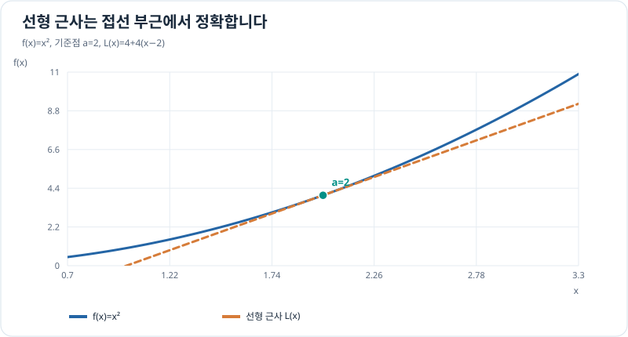

# 선형 근사와 테일러 급수

미분은 한 점 근처에서 함수가 어떻게 변하는지 알려 줍니다. **근사(approximation)**는 이 정보를 이용해 복잡한 함수를 간단한 다항식으로 바꾸는 방법입니다. 센서 보정, 모델 선형화, 오차 추정, 수치 계산을 이해하기 위한 선수 지식입니다.

## 순서와 완료 기준

| 순서 | 문서 | 핵심 질문 |
| --- | --- | --- |
| 1 | [선형 근사와 미분](linear-approximation.md) | 접선이 함수값을 얼마나 잘 예측하는가? |
| 2 | [수열·급수의 기초](sequences-and-series.md) | 무한히 많은 항을 더할 수 있는 조건은 무엇인가? |
| 3 | [테일러·매클로린 다항식](taylor-polynomials.md) | 여러 도함수로 얼마나 정교하게 근사할 수 있는가? |
| 4 | [나머지항과 오차 경계](taylor-remainder.md) | 근삿값이 얼마나 틀릴지 어떻게 추정하는가? |

필수는 1·3·4번의 **근사 원리와 오차 감각**입니다. 2번은 무한급수와 다항식 근사의 차이를 이해하는 데 필요한 범위까지만 학습합니다.

## 그래프로 이해하기

*접선은 한 점에서는 값과 기울기가 같지만 곡선과 완전히 일치하지 않습니다. 가까운 곳에서만 근사가 좋습니다.*

## 드론 공학과 연결

비선형 센서 측정이나 운동 방정식을 특정 상태 부근에서 1차식으로 근사하는 이유가 여기서 시작됩니다. 다변수 함수로 확장한 근사와 야코비안은 [다변수 미적분](../multivariable/index.md)에서 다룹니다.

**학습 완료 기준:** 접선 근사값을 구하고 실제값과 비교할 수 있으며, 테일러 차수가 증가하면 어떤 항이 추가되는지 설명하고 오차의 조건을 확인할 수 있습니다. 이는 문서의 작성 상태가 아니라 직접 문제를 풀어 확인해야 할 목표입니다.

[← 정적분 학습](../definite-integrals/index.md) · [다음: 선형 근사](linear-approximation.md)
