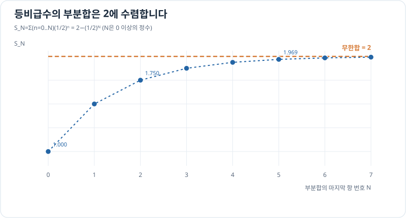

# 수열과 급수: 무한히 더한다는 뜻

> 근사 2/4 · 선수 지식: [극한과 연속](../functions/limits-and-continuity.md)

## 항의 극한과 합의 극한은 다르다

수열 $a_n$이 어떤 수로 가까워지는 것을 $a_n\to L$로 나타냅니다. **급수** $\sum_{n=0}^{\infty}a_n$는 수열의 항을 더한 **부분합** $S_N=\sum_{n=0}^{N}a_n$이 유한한 수로 수렴할 때만 값을 갖습니다.

항이 0으로 수렴하는 것은 급수 수렴의 **필요조건이지만 충분조건이 아닙니다.** 예를 들어 $1/n\to0$이어도 조화급수 $\sum_{n=1}^{\infty}1/n$은 발산합니다.

## 그래프로 이해하기

*항을 더할수록 부분합이 2에 가까워지지만, 각 유한 부분합은 2보다 작습니다.*

## 등비급수의 수렴

공비 $r$의 등비급수는 $|r|<1$일 때만

\[
\sum_{n=0}^{\infty}ar^n=\frac{a}{1-r}
\]

으로 수렴합니다. 유한한 부분합은 $S_N=a(1-r^{N+1})/(1-r)$이므로, $r^{N+1}\to0$에서 위 식이 나옵니다.

## 문제 예시: 점점 작아지는 보정량 합

정규화된 가상 보정값이 $1,\frac12,\frac14,\ldots$로 줄어든다고 가정합니다. 첫 네 항의 합과 무한합, 남은 합을 비교하세요.

**풀이.** $a=1$, $r=1/2$입니다. 첫 네 항(지수 $0$부터 $3$)은

\[
S_3=1+\frac12+\frac14+\frac18=\frac{15}{8}=1.875.
\]

무한합은 $1/(1-1/2)=2$이고 나머지는 $2-15/8=1/8=0.125$입니다. 이는 정해진 등비 모델에 대한 수학적 계산이지 특정 센서의 실제 보정량은 아닙니다.

## 확인 문제

$\sum_{n=0}^{\infty}3(1/4)^n$은 수렴할까요? 수렴하면 합을 구해 보세요.

## 확인 문제 풀이

$|1/4|<1$이므로 수렴하고 합은 $3/(1-1/4)=4$입니다. 반대로 공비가 2라면 항 자체가 0으로 가지 않으므로 발산합니다.

**학습 메모:** 무한합을 실제 계산할 때는 충분한 항에서 자르는 **절단오차**가 생깁니다. 테일러 근사에서도 유사한 오차를 만납니다.

[← 이전: 선형 근사](linear-approximation.md) · [다음: 테일러 다항식](taylor-polynomials.md)
