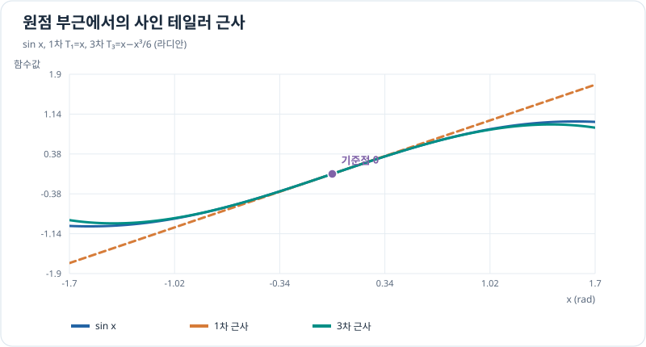

# 테일러·매클로린 다항식

> 근사 3/4 · 선수 지식: [고계도함수](../differentiation/trajectory-derivatives.md), [급수](sequences-and-series.md)

## 접선보다 더 정교한 근사

1차 근사는 함수값과 일계도함수만 맞춥니다. 기준점 $a$에서 **더 높은 도함수까지** 맞추면 $n$차 테일러 다항식을 얻습니다.

\[
\boxed{T_n(x)=\sum_{k=0}^{n}\frac{f^{(k)}(a)}{k!}(x-a)^k.}
\]

$a=0$이면 **매클로린(Maclaurin)** 다항식입니다. $f(x)=T_n(x)+R_n(x)$이며, 나머지항 $R_n$을 무시할 수 있는 범위에서만 좋은 근사가 됩니다.

예를 들어 $\sin x$의 $a=0$ 근사에는

\[
\sin x\approx x-\frac{x^3}{6}
\]

가 있습니다. 이 식은 작은 $x$에서만 정확도가 높고 각도 단위는 라디안입니다.

## 그래프로 이해하기

*차수가 높아지면 원점 근처에서 곡선을 더 잘 따라가지만, 아무 입력에서도 항상 더 정확하다고 단정하지 않습니다.*

## 문제 예시: 작은 회전각의 사인 근사

작은 회전각 $x=0.2$ rad일 때 $\sin x$를 1차 $T_1=x$와 3차 $T_3=x-x^3/6$으로 각각 근사하세요.

**풀이.** 먼저

\[
T_1(0.2)=0.2,\qquad
T_3(0.2)=0.2-\frac{0.008}{6}
\approx0.198666667.
\]

정확한 값은 $\sin(0.2)\approx0.198669331$입니다. 1차 근사 오차는 약 $0.001331$, 3차 근사 오차는 약 $0.000002664$입니다. 이 예에서는 3차 근사가 더 정확합니다.

## 확인 문제

$e^x$의 원점 기준 2차 매클로린 다항식과 $x=0.1$에서의 근삿값을 구하세요.

## 확인 문제 풀이

$e^x$의 모든 도함수는 $e^x$이고 $x=0$에서는 모두 1이므로

\[
T_2(x)=1+x+\frac{x^2}{2}.
\]

$T_2(0.1)=1.105$이며 $e^{0.1}\approx1.105170$과 가깝습니다.

[← 이전: 급수](sequences-and-series.md) · [다음: 근사 오차](taylor-remainder.md)
