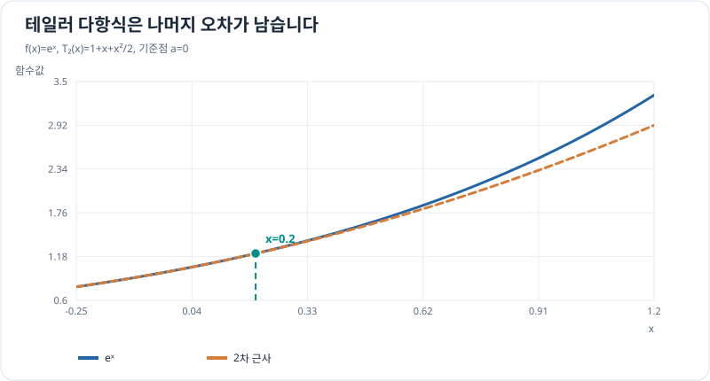

# 테일러 근사의 나머지항과 오차

> 근사 4/4 · 선수 지식: [테일러 다항식](taylor-polynomials.md)

## 근삿값과 실제값 사이의 차이

테일러 다항식은 함수 그 자체가 아닙니다. $n$차 근사의 오차는

\[
R_n(x)=f(x)-T_n(x)
\]

이며, $f$가 $a$와 $x$를 잇는 구간에서 $(n+1)$번 미분 가능하고 적절한 연속성 조건을 만족하면 라그랑주 나머지항이 성립합니다.

\[
R_n(x)=\frac{f^{(n+1)}(\xi)}{(n+1)!}(x-a)^{n+1}
\]

여기서 $\xi$는 $a$와 $x$ 사이의 어떤 점입니다. 해당 구간에서 $|f^{(n+1)}(t)|\le M$이면

\[
\boxed{|R_n(x)|\le\frac{M}{(n+1)!}|x-a|^{n+1}}.
\]

이 값은 실제 오차 자체가 아니라 **확실히 넘지 않는 상한**입니다.

## 그래프로 이해하기

*기준점 0에서는 함수값과 앞 두 도함수가 맞지만, 떨어진 입력에는 잔여 오차가 있습니다.*

## 문제 예시: 지수함수 근사의 오차 상한

$e^{0.2}$를 $a=0$의 2차 다항식 $T_2(x)=1+x+x^2/2$로 계산하고 실제 오차가 상한 안에 드는지 확인하세요.

**풀이.** $T_2(0.2)=1+0.2+0.02=1.22$입니다. $f'''(x)=e^x$이므로 $[0,0.2]$에서 $M=e^{0.2}$를 사용할 수 있습니다.

\[
|R_2(0.2)|\le\frac{e^{0.2}(0.2)^3}{6}
\approx0.001629.
\]

실제값은 $e^{0.2}\approx1.221403$이어서 오차는 약 $0.001403$입니다. 상한보다 작으므로 계산과 부합합니다.

## 확인 문제

$\sin x$를 $x=0$에서 $T_1(x)=x$로 근사합니다. $|x|\le0.1$ 구간에서 $|\sin x-x|$의 오차 상한 하나를 구하세요.

## 확인 문제 풀이

이계도함수 $f''(x)=-\sin x$는 해당 구간에서 $|f''(x)|\le1$입니다. 1차 라그랑주 나머지항에서

\[
|R_1(x)|\le\frac{1}{2}|x|^2\le0.005.
\]

이는 **보수적인 상한**입니다. 더 날카로운 상한은 추가 성질을 이용할 때 얻을 수 있습니다.

[← 이전: 테일러 다항식](taylor-polynomials.md) · [근사 단원 목차](index.md) · [다음: 매개변수 곡선](../parametric-curves/index.md)
