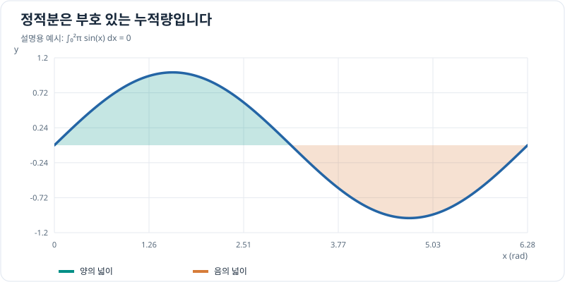

# 정적분 학습 개요

## 그래프로 이해하기

*정적분은 x축 위의 기여를 양수, 아래의 기여를 음수로 누적합니다. 이 예에서는 두 넓이가 상쇄되어 적분값이 0입니다.*

## 학습 목적

정적분(Definite Integral)은 구간에서 변화하는 양을 누적해 전체 변화량을 계산하는 도구입니다. 미분이 순간 변화율을 설명한다면 정적분은 그 변화율을 구간에 걸쳐 누적합니다. 그래프의 **부호 있는 면적**이라는 해석과 물리량의 **누적값**이라는 해석을 연결하는 것이 목표입니다.

## 선수 지식

- [함수의 극한과 연속](../functions/limits-and-continuity.md): 극한과 연속성
- [미분계수와 도함수](../differentiation/derivatives-and-tangents.md): 순간 변화율
- [부정적분 개요](../indefinite-integrals/index.md): 원시함수와 기본 적분법

## 권장 학습 순서

| 순서 | 소주제 | 핵심 질문 | 우선순위 |
| --- | --- | --- | --- |
| 1 | [정적분과 리만 합](riemann-sums.md) | 작은 구간의 합이 왜 연속적인 누적량이 되는가? | 필수 |
| 2 | [미적분학의 기본정리](fundamental-theorem.md) | 원시함수로 누적량을 계산할 수 있는 이유는 무엇인가? | 필수 |
| 3 | [정적분의 성질](properties-and-signed-area.md) | 구간 분할과 순서, 부호가 값에 어떤 영향을 주는가? | 필수 |
| 4 | [정적분의 치환적분](substitution.md) | 변수를 바꿀 때 적분 구간은 어떻게 바뀌는가? | 필수 |
| 5 | [정적분의 부분적분](integration-by-parts.md) | 곱 형태의 함수를 어떻게 적분하는가? | 권장 |
| 6 | [물리량의 누적 계산](physical-applications.md) | 속도·가속도·전류·전력에서 무엇을 누적하는가? | 필수 |
| 7 | [수치적분](numerical-integration.md) | 측정된 이산 데이터로 적분값을 어떻게 근사하는가? | 권장 |

각 행의 문서를 **1번부터 7번까지 순서대로** 읽으세요. 각 페이지는 개념 설명 → 풀이가 있는 예제 → 확인 문제 → 확인 문제 풀이 → 다음 장 링크로 구성했습니다. 먼저 풀이를 가리고 직접 계산한 뒤 정답을 확인하는 방식을 권장합니다.

## 핵심 개념 미리 보기

### 리만 합과 정적분

구간 $[a,b]$를 $n$개의 같은 폭으로 나누고, 각 작은 구간에서 선택한 점을 $x_i^*$라 하면

\[
\Delta x=\frac{b-a}{n},\qquad
\int_a^b f(x)\,dx=\lim_{n\to\infty}\sum_{i=1}^{n} f(x_i^*)\Delta x.
\]

이 식은 함수가 구간에서 리만 적분 가능할 때 성립합니다. 적분값은 그래프 아래의 무조건적인 넓이가 아니라, $x$축 위아래를 구분하는 **부호 있는 넓이**입니다.

### 미적분학의 기본정리

연속함수 $f$의 원시함수 $F$가 $F'(x)=f(x)$를 만족하면

\[
\int_a^b f(x)\,dx=F(b)-F(a).
\]

적분을 직접 무한히 더하지 않고도 양 끝점의 원시함수 값 차이로 계산할 수 있습니다.

### 구간 분할과 방향

\[
\int_a^c f(x)\,dx=\int_a^b f(x)\,dx+\int_b^c f(x)\,dx,
\qquad
\int_a^b f(x)\,dx=-\int_b^a f(x)\,dx.
\]

## 공학적 활용

| 물리량 | 관계 | 해석 |
| --- | --- | --- |
| 변위 | $\Delta x=\int_{t_0}^{t_1}v(t)\,dt$ | 속도의 시간 누적; 방향을 고려한 변위 |
| 속도 변화 | $\Delta v=\int_{t_0}^{t_1}a(t)\,dt$ | 가속도의 시간 누적 |
| 전하량 | $\Delta Q=\int_{t_0}^{t_1}I(t)\,dt$ | 전류의 시간 누적 |
| 에너지 | $E=\int_{t_0}^{t_1}P(t)\,dt$ | 전력의 시간 누적 |
| 제어 오차 | $\int_0^T e(t)\,dt$ | 양·음 오차가 상쇄될 수 있는 부호 있는 누적량 |

시간을 초(s) 단위로 적분할 때 속도(m/s)로부터 변위(m), 전력(W)으로부터 에너지(J)가 나오는 것처럼 **단위도 함께 검증**합니다. 속도가 음수가 될 수 있으면 $\int v(t)\,dt$는 이동 거리 대신 변위이며, 총 이동 거리는 $\int |v(t)|\,dt$로 계산합니다.

## 학습 범위와 완료 기준

치환적분과 부분적분은 기본적인 형태를 연습합니다. 복잡한 삼각치환, 특수함수 적분, 고난도 이상적분, 리만 적분 존재성의 엄밀한 증명은 지금 단계에서 생략합니다.

학습을 마치면 리만 합의 직관, 정적분과 부정적분의 차이, 미적분학 기본정리를 설명하고, 부호와 단위를 구분하여 실제 또는 가상 측정 데이터의 누적량을 구할 수 있어야 합니다. 마지막에는 Python으로 사다리꼴법을 구현하여 해석적 적분값과 근사 오차를 비교합니다.

**첫 학습 페이지:** [정적분과 리만 합](riemann-sums.md) — 시간에 따라 달라지는 속도를 작은 시간 구간의 합으로 근사하기.
