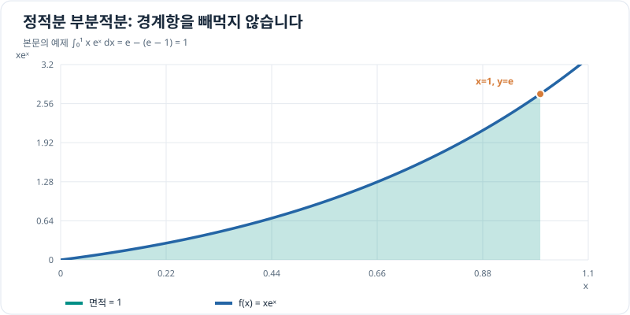

# 정적분의 부분적분

> 정적분 5/7 · 권장 학습 시간: 25~35분  
> 선수 지식: [미분의 곱셈법칙](../differentiation/basic-rules.md), [부정적분의 부분적분](../indefinite-integrals/integration-by-parts.md)

## 그래프로 이해하기

*본문의 정적분 ∫₀¹xeˣdx는 부분적분으로 1입니다. 경계항 [xeˣ]₀¹=e와 남는 적분 e−1의 차를 계산합니다.*

## 두 함수의 곱을 적분해야 한다면?

두 함수가 곱해져 있고, 한쪽을 미분하면 간단해지고 다른 쪽은 적분하기 쉽다면 **부분적분(Integration by Parts)**을 고려합니다. 미분의 곱셈법칙

\[
(uv)'=u'v+uv'
\]

을 $a$부터 $b$까지 적분하면

\[
[u(x)v(x)]_a^b
=\int_a^b u'(x)v(x)\,dx
+\int_a^b u(x)v'(x)\,dx.
\]

항을 옮겨 정리하면

\[
\boxed{\int_a^b u\,dv=[uv]_a^b-\int_a^b v\,du}
\]

가 됩니다. 부정적분의 공식과 달리 **양 끝점에서 $uv$를 평가한다**는 차이가 있습니다.

## 두 부분을 어떻게 선택할까?

- $u$: 미분하면 더 간단해지는 식(예: $x$, $x^2$, $\ln x$)
- $dv$: 원시함수를 쉽게 구할 수 있는 부분(예: $e^x\,dx$, $\cos x\,dx$)

$u$를 미분해서 $du$를 구하고 $dv$를 적분해서 $v$를 구합니다. 그런 다음 남은 $\int v\,du$가 원래 적분보다 쉬워졌는지 확인합니다.

## 문제 예시: 시간에 비례하는 가중치를 곱한 지수 함수

다음 정적분을 계산해 봅니다.

\[
I=\int_0^1 x e^x\,dx.
\]

이 식은 정규화된 시간 $x$와 지수 신호 $e^x$의 곱을 누적하는 간단한 수학적 모델로 볼 수 있습니다.

**풀이.** $u=x$, $dv=e^x\,dx$로 선택하면 $du=dx$, $v=e^x$입니다. 따라서

\[
\begin{aligned}
I&=[xe^x]_0^1-\int_0^1 e^x\,dx\\
&=e-[e^x]_0^1\\
&=e-(e-1)=1.
\end{aligned}
\]

검산을 위해 원시함수 $(x-1)e^x$를 미분하면 $xe^x$가 됩니다. 따라서

\[
[(x-1)e^x]_0^1=0-(-1)=1
\]

로도 확인됩니다.

## 자주 발생하는 실수

첫째, 정적분인데도 $[uv]_a^b$를 $uv$로만 쓰고 **끝점 차이를 빠뜨리는 것**입니다.

둘째, $dv$의 적분을 틀리는 것입니다. 예를 들어 $dv=\cos x\,dx$이면 $v=\sin x$이고, $dv=e^{-x}\,dx$이면 $v=-e^{-x}$입니다.

셋째, 더 복잡한 적분으로 바꿔 놓고도 공식만 기계적으로 반복하는 것입니다. 다항식처럼 직접 적분하는 편이 더 간단한 식에는 굳이 부분적분을 사용할 필요가 없습니다.

## 확인 문제

다음을 계산해 보세요.

\[
\int_0^1 x\cos x\,dx.
\]

$u=x$, $dv=\cos x\,dx$로 두고, 끝점의 함수값까지 계산해 보세요.

## 확인 문제 풀이

$du=dx$, $v=\sin x$이므로

\[
\begin{aligned}
\int_0^1 x\cos x\,dx
&=[x\sin x]_0^1-\int_0^1\sin x\,dx\\
&=\sin1+[\cos x]_0^1\\
&=\sin1+\cos1-1.
\end{aligned}
\]

각도는 라디안 단위이며, 값은 약 $0.382$입니다. 원시함수 $x\sin x+\cos x$를 미분해도 $x\cos x$가 나옵니다.

## 이번 장에서 기억할 것

- 부분적분은 **곱의 미분법을 거꾸로 적용**하는 기법입니다.
- 정적분에서는 $[uv]_a^b$처럼 경계값을 계산해야 합니다.
- 목표는 적분을 더 쉽게 만드는 것이지 반드시 부분적분을 사용하는 것이 아닙니다.

[← 이전: 정적분의 치환적분](substitution.md) · [다음: 물리량의 누적 →](physical-applications.md)
