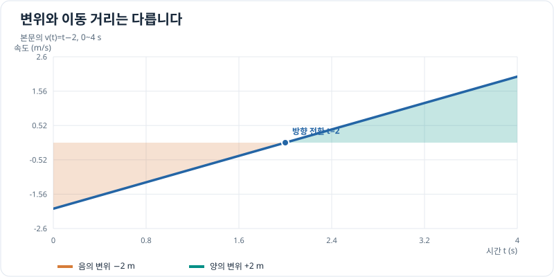

# 정적분의 성질과 부호

> 정적분 3/7 · 권장 학습 시간: 25~35분  
> 선수 지식: [미적분학의 기본정리](fundamental-theorem.md)

## 그래프로 이해하기

*본문의 v(t)=t−2는 0~2초의 변위 −2m와 2~4초의 변위 +2m가 상쇄됩니다. 이동 거리는 절댓값의 합인 4m입니다.*

## 정적분은 언제 음수가 될까?

정적분은 단순히 모양의 넓이를 더하는 값이 아닙니다. $x$축 위쪽은 양수, 아래쪽은 음수로 계산한 **부호 있는 넓이(signed area)**입니다. 그래서 서로 상쇄되어 정적분이 0일 수도 있습니다.

속도 그래프라면 이 부호는 물체의 **운동 방향**과 연결됩니다. 이동 거리는 항상 음수가 아니지만, 변위는 음수일 수 있습니다.

## 구간을 나누어 더하기

함수 $f$가 적분 가능하면 중간점 $c$에서 구간을 나눌 수 있습니다.

\[
\int_a^b f(x)\,dx
=\int_a^c f(x)\,dx+\int_c^b f(x)\,dx.
\]

특히 $f$가 부호를 바꾸는 지점에서 분할하면 변위와 이동 거리를 구별하기 쉽습니다.

적분 방향을 뒤집으면 부호가 바뀌고, 시작점과 끝점이 같으면 값은 0입니다.

\[
\int_b^a f(x)\,dx=-\int_a^b f(x)\,dx,
\qquad
\int_a^a f(x)\,dx=0.
\]

## 합과 상수 배의 적분

$f,g$가 적분 가능하고 $c$가 상수이면

\[
\int_a^b(f(x)+g(x))\,dx
=\int_a^b f(x)\,dx+\int_a^b g(x)\,dx,
\]

\[
\int_a^b cf(x)\,dx=c\int_a^b f(x)\,dx.
\]

합을 나누어 계산할 수 있지만, **곱의 적분을 적분의 곱으로 나눌 수는 없습니다.** 예를 들어 $\int_0^1 x^2\,dx=1/3$인데 $(\int_0^1 x\,dx)^2=1/4$로 서로 다릅니다.

## 문제 예시: 왕복 운동의 변위와 이동 거리

물체가 $0\le t\le4$초 동안 $v(t)=t-2$ (m/s, $t$는 초 단위의 수치)로 움직입니다. 변위와 전체 이동 거리를 비교합니다.

**풀이.** $t<2$일 때 속도는 음수이고 $t>2$일 때는 양수입니다. 먼저 구간별 **변위**를 계산하면

\[
\int_0^2(t-2)\,dt
=\left[\frac{t^2}{2}-2t\right]_0^2=-2\,\mathrm m,
\]

\[
\int_2^4(t-2)\,dt
=\left[\frac{t^2}{2}-2t\right]_2^4=2\,\mathrm m.
\]

전체 변위는 $-2+2=0$ m입니다. 하지만 한쪽으로 2m 갔다가 반대로 2m 돌아왔으므로 **전체 이동 거리**는 $2+2=4$ m입니다.

\[
\text{변위}=\int_0^4v(t)\,dt=0,
\qquad
\text{이동 거리}=\int_0^4|v(t)|\,dt=4.
\]

마지막 위치가 처음과 같다고 해서 움직이지 않았다는 뜻은 아닙니다.

## 확인 문제

$v(t)=3-t$ (m/s, $t$는 초 단위의 수치)이고 $0\le t\le4$초일 때 **변위**와 **이동 거리**를 각각 구해 보세요. 속도의 부호가 바뀌는 시점부터 찾으세요.

## 확인 문제 풀이

$v(t)=0$인 시점은 $t=3$초입니다.

\[
\text{변위}=\int_0^4(3-t)\,dt
=\left[3t-\frac{t^2}{2}\right]_0^4=4\,\mathrm m.
\]

처음 3초의 거리는 $4.5$ m이고, 다음 1초 동안 반대 방향으로 움직인 거리는 $0.5$ m입니다.

\[
\text{이동 거리}
=\int_0^3(3-t)\,dt+\int_3^4(t-3)\,dt
=4.5+0.5=5\,\mathrm m.
\]

## 이번 장에서 기억할 것

- 정적분은 부호를 가지며, 방향을 반대로 하면 적분값의 부호도 반대입니다.
- 구간 분할과 선형성을 이용해 복잡한 계산을 나눌 수 있습니다.
- 속도 적분은 **변위**, 속도의 절댓값 적분은 **이동 거리**입니다.

[← 이전: 미적분학의 기본정리](fundamental-theorem.md) · [다음: 정적분의 치환적분 →](substitution.md)
