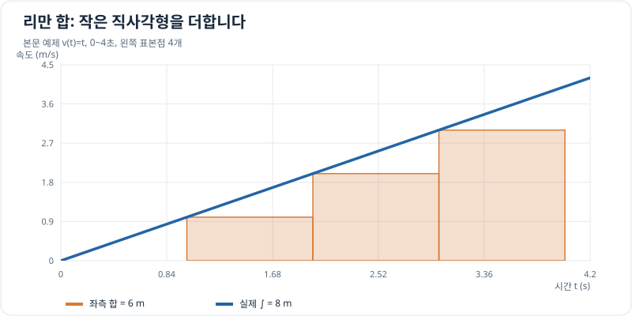

# 정적분과 리만 합

> 정적분 1/7 · 권장 학습 시간: 30~40분  
> 선수 지식: [함수의 극한과 연속](../functions/limits-and-continuity.md)

## 그래프로 이해하기

*본문 예제의 1초 간격 좌측 합은 6m이며 실제 정적분은 8m입니다. 직사각형 폭을 줄이면 부족한 넓이가 줄어듭니다.*

## 왜 작은 양을 더해야 할까?

물체가 일정한 속도 $v$로 $\Delta t$초 동안 움직이면 이동 거리는 $v\Delta t$입니다. 속도가 매 순간 바뀌면 전체 시간을 작은 구간으로 나누어 **각 구간의 속도 × 시간**을 더해 근사합니다. 시간 구간을 점점 잘게 나눈 합의 극한이 정적분입니다.

속도 $v(t)$가 양수라면 속도 그래프 아래 넓이가 이동 거리입니다. 음수인 구간이 있으면 면적을 음수로 계산한 **변위**가 됩니다. 이동 거리와 변위는 다를 수 있습니다.

## 리만 합을 만드는 순서

$t=a$부터 $t=b$까지의 구간을 같은 길이 $n$개로 나눕니다.

\[
\Delta t=\frac{b-a}{n}.
\]

$i$번째 작은 구간에서 선택한 시간을 $t_i^*$라 하면 속도 $v(t_i^*)$가 잠시 일정하다고 가정해

\[
S_n=\sum_{i=1}^{n}v(t_i^*)\Delta t
\]

로 변위를 근사합니다. 각 구간에서 **왼쪽 끝점**을 선택하면 좌측 합, **오른쪽 끝점**을 선택하면 우측 합입니다.

연속함수처럼 리만 적분 가능한 함수에서는 구간을 잘게 나누면 표본점 선택의 영향이 사라집니다.

\[
\boxed{\int_a^b v(t)\,dt=\lim_{n\to\infty}S_n}
\]

여기서 $dt$는 적분하는 변수가 시간임을 나타냅니다. 속도의 단위가 m/s, $dt$의 단위가 s이므로 결과는 m입니다. 무한히 많은 값을 실제로 하나씩 더한다는 뜻이 아니라 **유한 합의 극한으로 정의한다**는 뜻입니다.

## 문제 예시: 시간에 따라 빨라지는 물체의 변위

가상의 직선 운동에서 $0\le t\le4$초 동안 속도 수치를 $v(t)=t$ (m/s, $t$는 초 단위의 수치)로 둡니다. 1초 폭의 직사각형 4개로 좌측 합과 우측 합을 구하고, 구간을 잘게 나누면 어디로 수렴하는지 살펴봅니다.

**풀이.** 네 구간의 폭은 $\Delta t=1$초입니다.

| 구간(s) | 좌측 속도(m/s) | 우측 속도(m/s) |
| --- | ---: | ---: |
| 0~1 | 0 | 1 |
| 1~2 | 1 | 2 |
| 2~3 | 2 | 3 |
| 3~4 | 3 | 4 |

\[
L_4=(0+1+2+3)\times1=6\,\mathrm m,
\qquad
R_4=(1+2+3+4)\times1=10\,\mathrm m.
\]

속도가 증가하므로 좌측 합은 실제 변위보다 작고 우측 합은 큽니다. $n$개의 구간으로 나누면 $\Delta t=4/n$이며,

\[
L_n=\frac{16}{n^2}\sum_{i=0}^{n-1}i
=8\left(1-\frac1n\right),
\]

\[
R_n=\frac{16}{n^2}\sum_{i=1}^{n}i
=8\left(1+\frac1n\right).
\]

두 합 모두 $n\to\infty$에서 $8\,\mathrm m$로 수렴하므로

\[
\int_0^4 t\,dt=8.
\]

지금은 적분 공식을 외우지 않고 **근삿값이 왜 같은 극한으로 다가가는지**를 이해하면 됩니다.

## 확인 문제

$v(t)=2t$ (m/s, $t$는 초 단위의 수치)로 움직이는 가상 물체가 있습니다. $0\le t\le3$초를 폭 1초의 구간 3개로 나눴을 때 **좌측 합**은 얼마일까요? 실제 변위보다 큰지 작은지도 생각해 보세요.

계산을 먼저 한 후 아래 풀이를 읽어 보세요.

## 확인 문제 풀이

좌측 끝점 $t=0,1,2$에서 속도는 $0,2,4$ m/s입니다.

\[
L_3=(0+2+4)\times1=6\,\mathrm m.
\]

속도가 증가하므로 좌측 합은 실제 변위를 과소평가합니다. 실제 변위는 $\int_0^3 2t\,dt=9\,\mathrm m$입니다. 다음 장에서 이 값을 원시함수로 바로 계산하는 방법을 배웁니다.

## 이번 장에서 기억할 것

- 정적분은 잘게 나눈 구간의 **변화율 × 구간 폭**을 더한 합의 극한입니다.
- 좌측·우측 합은 근삿값이며, 구간 폭을 줄이면 수렴합니다(리만 적분 가능한 경우).
- 속도를 시간에 대해 적분하면 변위가 나오며, 단위는 m입니다.

[← 정적분 개요](index.md) · [다음: 미적분학의 기본정리 →](fundamental-theorem.md)
