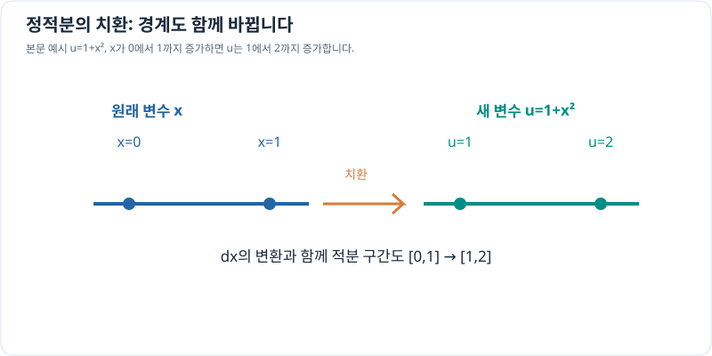

# 정적분의 치환적분

> 정적분 4/7 · 권장 학습 시간: 30~40분  
> 선수 지식: [정적분의 기본정리](fundamental-theorem.md), [부정적분의 치환적분](../indefinite-integrals/substitution.md)

## 그래프로 이해하기

*본문 예제에서 x=0,1은 각각 u=1,2에 대응합니다. 치환적분에서는 식과 미분 요소뿐 아니라 경계도 함께 옮겨야 합니다.*

## 안쪽 함수를 다른 변수로 바꾸기

연쇄법칙은 $F(g(x))$를 미분하면 $F'(g(x))g'(x)$가 된다고 알려 줍니다. 치환적분은 이 규칙을 거꾸로 이용합니다. **정적분에서는 적분 변수뿐 아니라 적분 구간의 양 끝도 함께 바꾸어야** 합니다.

함수 $g$가 미분 가능하고 $f$가 관련 구간에서 연속일 때

\[
\boxed{
\int_a^b f(g(x))g'(x)\,dx
=\int_{g(a)}^{g(b)}f(u)\,du
}
\]

가 성립합니다. $u=g(x)$로 두면 $du=g'(x)\,dx$이고, 원래의 $x=a$와 $x=b$는 새 변수의 범위 $u=g(a)$와 $u=g(b)$로 옮겨집니다.

## 계산하는 순서

1. 반복 등장하는 **안쪽 식**을 $u=g(x)$로 정합니다.
2. $du=g'(x)\,dx$를 구해 적분식 전체를 $u$로 바꿉니다.
3. 원래 하한 $a$, 상한 $b$를 각각 $g(a)$와 $g(b)$로 바꿉니다.
4. 새 변수 $u$의 정적분을 계산합니다.
5. 필요한 경우 원래 식을 직접 미분하거나 수치로 확인합니다.

**중요:** $u$로 적분하면서 구간을 $x$의 숫자로 그대로 두지 않습니다. 새 경계값을 썼다면 답을 구할 때 다시 $x$로 복원할 필요도 없습니다.

## 문제 예시: 합성함수의 정적분 계산

다음 값을 구해 봅니다.

\[
I=\int_0^1 2x(1+x^2)^2\,dx.
\]

**풀이.** 안쪽 식을 $u=1+x^2$로 두면 $du=2x\,dx$입니다. 경계값은 $x=0\Rightarrow u=1$, $x=1\Rightarrow u=2$입니다.

\[
\begin{aligned}
I&=\int_1^2 u^2\,du\\
&=\left[\frac{u^3}{3}\right]_1^2
=\frac{8-1}{3}
=\frac73.
\end{aligned}
\]

직접 전개해서 검산하면 $2x(1+x^2)^2=2x+4x^3+2x^5$이고,

\[
\left[x^2+x^4+\frac{x^6}{3}\right]_0^1
=1+1+\frac13=\frac73
\]

로 같은 결과가 나옵니다. 치환은 원래 식의 값을 바꾸는 것이 아니라 **계산하기 쉬운 형태로 표현을 바꾸는 것**입니다.

## 경계가 반대로 바뀌는 경우

$u=g(x)$가 감소하는 구간에서는 치환 후 새 하한이 상한보다 클 수 있습니다. 그래도 그대로 계산하면 됩니다.

\[
\int_0^1 -2x\,e^{-x^2}\,dx
=\int_0^1 e^{-u}(-du)
=e^{-1}-1.
\]

위에서는 $u=x^2$로 뒀기 때문에 실제로는 $-du$가 남습니다. 혹은 $u=-x^2$로 놓으면 $du=-2x\,dx$이고 **새 경계가 $0\to-1$**이 되어 같은 값을 얻습니다. 두 방식을 섞어 부호를 두 번 뒤집지 않도록 주의합니다.

## 확인 문제

다음을 치환적분으로 계산해 보세요.

\[
\int_0^2\frac{2x}{1+x^2}\,dx.
\]

힌트: 분모에 있는 식의 도함수가 분자와 같은지 확인하세요.

## 확인 문제 풀이

$u=1+x^2$, $du=2x\,dx$이고, 경계는 $x=0\Rightarrow u=1$, $x=2\Rightarrow u=5$입니다.

\[
\int_0^2\frac{2x}{1+x^2}\,dx
=\int_1^5\frac1u\,du
=[\ln u]_1^5=\ln5.
\]

$u$가 이 구간에서 양수이므로 $\ln|u|=\ln u$입니다.

## 이번 장에서 기억할 것

- 치환적분은 합성함수의 미분을 거꾸로 적용합니다.
- **적분 구간도 새 변수에 맞춰 변경**해야 합니다.
- 부정적분과 달리 정적분에서는 최종적으로 원래 변수로 돌아오지 않아도 됩니다.

[← 이전: 정적분의 성질](properties-and-signed-area.md) · [다음: 정적분의 부분적분 →](integration-by-parts.md)
