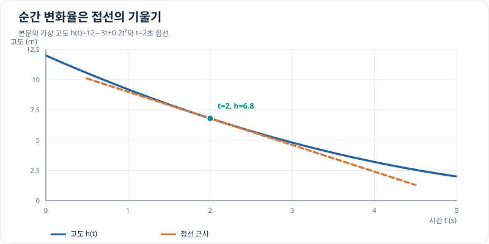

# 미분계수와 도함수

시간 $t$에 따른 위치 $s(t)$의 평균속도는 $[s(t+\Delta t)-s(t)]/\Delta t$입니다. [함수의 극한](../functions/limits-and-continuity.md)으로 $\Delta t\to0$을 다룰 수 있으면 **순간속도**인 도함수

\[
s'(t)=\lim_{\Delta t\to0}\frac{s(t+\Delta t)-s(t)}{\Delta t}
\]

가 됩니다. 도함수가 존재하면 그 점에서 함수는 연속이지만, 연속이라고 항상 미분 가능한 것은 아닙니다. 예를 들어 $|t|$는 0에서 연속이지만 좌우 기울기가 달라 미분 불가능합니다.

**공을 위로 던진 예.** 위쪽을 양의 방향으로 잡고, 공기 저항 없이 중력가속도를 $9.8\,\mathrm{m/s^2}$로 일정하게 두면 $s(t)=30t-4.9t^2$입니다. 원래 기록의 `30ㅅ`은 $30t$로 해석합니다. 단위는 $s$가 m, $t$가 s입니다.

\[
\begin{aligned}
\frac{s(t+\Delta t)-s(t)}{\Delta t}
&=30-9.8t-4.9\Delta t,\\
s'(t)&=30-9.8t.
\end{aligned}
\]

$t=5\,\mathrm s$에서 높이는 $s(5)=27.5\,\mathrm m$, 순간속도는 $s'(5)=-19\,\mathrm{m/s}$입니다. 음수는 공이 **아래로 내려가는 중**임을 뜻합니다. 이 단순 모델에서 출발 높이로 돌아오는 때는 약 $6.12\,\mathrm s$입니다.

순간속도 시뮬레이션: 시각을 바꾸며 접선 확인하기

시각을 바꾸면 위치 곡선의 점, 접선, 순간속도가 함께 바뀝니다. 축은 고정되어 있으며 툴팁은 시간과 높이를 보여줍니다.

<iframe src="../../../../simulations/instantaneous-velocity/index.html?v=calculus-1" title="순간속도 시뮬레이터" width="100%" height="640" loading="lazy" style="border: 1px solid #ddd; border-radius: 8px;"></iframe>

<a href="../../../../simulations/instantaneous-velocity/index.html?v=calculus-1" target="_blank" rel="noopener">시뮬레이터 새 창에서 열기</a> · <a href="https://github.com/koosco/applied-science/blob/main/simulations/instantaneous_velocity.py">Python 원본 코드</a>

## 그래프로 이해하기

*본문 예제처럼 t=2초의 도함수 −2.2m/s는 접선의 기울기입니다. 접선은 가까운 시점의 높이를 근사합니다.*

## 접선과 법선의 방정식

평면에서 $y=f(x)$의 $(a,f(a))$에서 접선 기울기가 $m=f'(a)$이면 접선은 $y-f(a)=m(x-a)$입니다. 이에 수직인 **법선**은 $m\ne0$일 때 $y-f(a)=-\frac1m(x-a)$입니다. $m=0$이면 법선은 수직선 $x=a$입니다. 접선 방향 벡터 $(1,m)$과 법선 방향 벡터 $(-m,1)$의 내적은 $-m+m=0$이므로 두 방향이 수직입니다.

예를 들어 경사진 지면을 국소적으로 $y=0.2x$로 나타내면 접선 방향은 $(1,0.2)$, 위쪽을 향한 법선 방향은 $(-0.2,1)$입니다. 이를 길이 1로 만들려면 $\sqrt{1+0.2^2}$로 나눕니다. 법선은 지면의 방향이나 접촉력의 방향을 기술하는 데 도움이 됩니다. 실제 착륙 제어에는 지형 측정, 기체 자세, 속도와 오차도 함께 고려해야 합니다. 여기서 지면의 $x,y$는 거리 좌표이며 위의 높이 대 시간 그래프와 서로 다른 평면입니다.

## 문제 예시: 드론 하강 고도의 국소 예측

드론의 시험 하강 고도를 $h(t)=12-3t+0.2t^2\,\mathrm m$로 모델링합니다. $t$는 초 단위 수치이고 $0\le t\le5$입니다. $t=2\,\mathrm s$에서 수직 속도를 구하고, 그 시점의 접선으로 $0.2\,\mathrm s$ 뒤 고도를 예측한 뒤 원래 식의 값과 비교해 보세요. 이 식은 짧은 구간의 가상 고도 계획입니다.

**풀이.** $h'(t)=-3+0.4t$이므로 $h'(2)=-2.2\,\mathrm{m/s}$이고 $h(2)=6.8\,\mathrm m$입니다. 접선 근사는

\[
h_{\mathrm{tan}}(t)=6.8-2.2(t-2),
\qquad
h_{\mathrm{tan}}(2.2)=6.36\,\mathrm m.
\]

원래 모델은 $h(2.2)=12-3(2.2)+0.2(2.2)^2=6.368\,\mathrm m$를 줍니다. 접선 예측과의 차이는 $0.008\,\mathrm m$입니다. 순간 변화율을 짧은 시간의 예측에 쓸 수 있지만, 시간 간격이 커질수록 곡률 때문에 오차가 커집니다.

## 문제 예시: 경사진 착륙면의 법선 방향

드론의 착륙면 단면을 수평 거리를 m 단위로 나타낸 수치 $x$에 따른 높이 $y(x)=0.1x^2\,\mathrm m$로 근사합니다. $x=2$에서 접선과 법선의 방정식을 구하고, 착륙면에서 위쪽을 향하는 단위 법선 벡터를 구해 보세요. 이는 지형의 한 단면만 나타낸 가상 모델입니다.

**풀이.** 접점은 $(2,0.4)\,\mathrm m$이고 $y'(x)=0.2x$이므로 접선 기울기는 $0.4$입니다. 따라서 접선은 $y-0.4=0.4(x-2)$, 법선은 $y-0.4=-2.5(x-2)$입니다. 접선 방향 $(1,0.4)$에 수직이며 위쪽을 향하는 벡터는 $(-0.4,1)$이므로 단위 법선은

\[
\mathbf n=\frac{(-0.4,1)}{\sqrt{1+0.4^2}}\approx(-0.371,0.928).
\]

내적 $(1,0.4)\cdot(-0.4,1)=0$으로 수직 관계를 확인할 수 있습니다. 이 벡터는 국소 지형의 방향이며, 실제 착륙 가능성은 기체의 자세와 지형의 3차원 형상도 확인해야 합니다.
