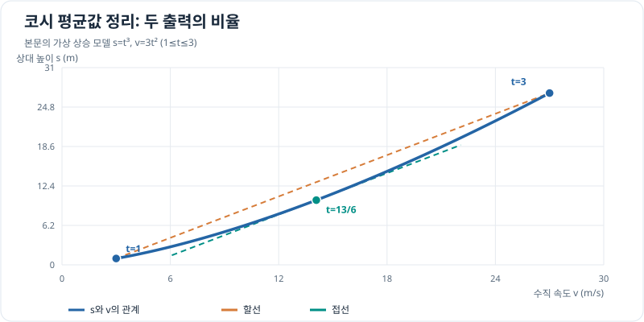

# 코시의 평균값 정리

두 물리량이 같은 시간 동안 변할 때, 구간 전체의 변화량 비율과 어느 한 순간의 변화율 비율을 연결할 수 있습니다. **코시의 평균값 정리**는 그 순간의 존재를 알려줍니다.

## 그래프로 이해하기

*본문의 s(t)=t³, v(t)=3t², t=1~3초 예시입니다. 가로축을 v, 세로축을 s로 두면 할선과 t=13/6초의 접선이 같은 기울기 13/12를 가집니다.*

## 정리와 성립 조건

$f,g$가 $[a,b]$에서 연속이고 $(a,b)$에서 미분 가능하면 어떤 $c\in(a,b)$가 존재하여

\[
[f(b)-f(a)]g'(c)=[g(b)-g(a)]f'(c)
\]

입니다. 이 곱셈 형태가 일반적인 진술입니다. $g(b)\ne g(a)$이고 $(a,b)$에서 $g'(x)\ne0$임을 확인했다면 나누어서

\[
\frac{f(b)-f(a)}{g(b)-g(a)}=\frac{f'(c)}{g'(c)}
\]

로 쓸 수 있습니다. $g(x)=x$를 대입하면 $g'(x)=1$이므로 익숙한 평균값 정리 $f'(c)=[f(b)-f(a)]/(b-a)$가 됩니다.

## 증명: 롤의 정리에서 유도하기

**1. 보조 함수 구성.** 두 함수의 끝점 변화량을 $\Delta f=f(b)-f(a)$, $\Delta g=g(b)-g(a)$라 둡니다. 두 변화를 결합해

\[
H(x)=\Delta g\,[f(x)-f(a)]-\Delta f\,[g(x)-g(a)]
\]

를 만듭니다.

**2. 양 끝값 확인.** $H(a)=0$이고 $H(b)=\Delta g\Delta f-\Delta f\Delta g=0$입니다. $f,g$의 연속성과 미분 가능성을 $H$도 물려받으므로 [롤의 정리](rolle.md)를 적용할 수 있습니다.

**3. 도함수 계산.** 따라서 어떤 $c\in(a,b)$에서 $H'(c)=0$입니다. 이를 전개하면 $\Delta g\,f'(c)-\Delta f\,g'(c)=0$이고, 항을 옮기면 $\Delta f\,g'(c)=\Delta g\,f'(c)$입니다.

**두 출력의 변화량을 섞어 끝값이 같은 함수로 만드는 것**이 증명의 핵심입니다. 비율 형태는 분모가 0이 아님을 추가로 확인한 뒤에만 얻습니다.

## 위치와 속도를 함께 보는 예

드론이 일정한 수직 가속도 $2\,\mathrm{m/s^2}$로 상승한다는 단순 모델에서 시간 $t$의 수치가 초 단위일 때 기준점으로부터의 높이를 $s(t)=t^2\,\mathrm m$, 수직 속도를 $v(t)=2t\,\mathrm{m/s}$라 합시다. $[1,2]$초 동안

\[
\frac{\Delta s}{\Delta v}
=\frac{(4-1)\,\mathrm m}{(4-2)\,\mathrm{m/s}}
=1.5\,\mathrm s.
\]

한편 $s'(t)=2t\,\mathrm{m/s}$, $v'(t)=2\,\mathrm{m/s^2}$이므로 $s'(t)/v'(t)=t\,\mathrm s$입니다. 따라서 $c=1.5\,\mathrm s$에서 순간 변화율의 비율이 구간 전체의 비율과 같습니다. 이 예에서는 식으로 $c$를 계산했지만 정리 자체는 그 값을 구해 주지 않습니다.

## 문제 예시: 비행 고도와 수직 속도의 변화

드론의 시험 상승 구간을 기준 고도에서의 상대 높이 $s(t)=t^3\,\mathrm m$, 수직 속도 $v(t)=3t^2\,\mathrm{m/s}$로 모델링합니다. $t$는 초 단위 시간의 수치이고 $1\le t\le3$입니다. 코시의 평균값 정리가 보장하는 시각 $c$를 찾고, 전체 변화량 비율과 순간 변화율 비율이 같은지 확인해 보세요. 이 식은 제어된 상승을 가정한 가상 운동 모델입니다.

**풀이.** 두 함수는 구간에서 연속이고 안쪽에서 미분 가능하며 $v'(t)=6t>0$입니다. 그러므로 비율 형태를 쓸 수 있습니다. 전체 구간에서는

\[
\frac{s(3)-s(1)}{v(3)-v(1)}
=\frac{(27-1)\,\mathrm m}{(27-3)\,\mathrm{m/s}}
=\frac{13}{12}\,\mathrm s.
\]

순간 변화율의 비율은 $s'(t)/v'(t)=3t^2/(6t)=t/2\,\mathrm s$입니다. 이를 $13/12\,\mathrm s$와 같게 두면 $c=13/6\approx2.17\,\mathrm s$이며, 실제로 $(1,3)$ 안에 있습니다. 이 정리는 **두 출력이 같은 시각에 어떻게 함께 변했는지**를 구간 전체와 한 순간에서 비교합니다.

코시의 정리는 다음 [로피탈의 정리](lhopital.md)에서 분자와 분모가 함께 0에 가까워지는 극한을 다루는 근거가 됩니다.
