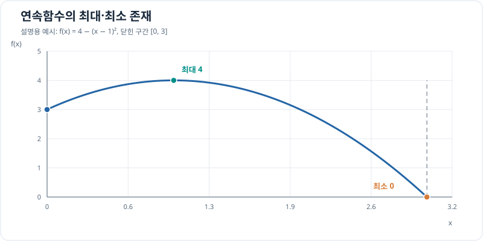

# 최대·최소 정리

[연속](limits-and-continuity.md) 함수가 닫힌 구간에서 가장 작은 값과 가장 큰 값을 실제로 갖는지를 판단합니다. 정리가 보장하는 것은 극값의 존재이며, 위치와 값은 주어진 함수로 계산합니다.

## 그래프로 이해하기

*원리 설명용 예시: f(x)=4−(x−1)²는 닫힌 구간 [0,3]에서 x=1의 최댓값 4와 x=3의 최솟값 0에 도달합니다.*

## 정리와 성립 조건

$f$가 **닫히고 유계인 구간** $[a,b]$에서 연속이면 $c,d\in[a,b]$가 존재하여 모든 $x\in[a,b]$에 대해 $f(c)\le f(x)\le f(d)$입니다. 즉 구간 안에서 최솟값과 최댓값을 실제로 가집니다.

## 증명: 값의 범위가 유한하고 끝값에 도달함

1. 먼저 함수값이 **유계**임을 보입니다. 위로 유계가 아니라면 각 자연수 $n$에 대해 $f(x_n)>n$인 $x_n\in[a,b]$를 고를 수 있습니다. 닫히고 유계인 구간 안의 수열에는 $x_{n_k}\to x_*\in[a,b]$인 부분수열이 있습니다. 연속성에 따르면 $f(x_{n_k})\to f(x_*)$인데, 왼쪽 값은 무한히 커져야 하므로 모순입니다. 아래로 유계인 것도 같은 방식으로 보입니다.
2. 함수값 집합의 유한한 상한을 $M=\sup\{f(x):x\in[a,b]\}$라 둡니다. 상한의 정의에 따라 매 $n$마다 $M-1/n<f(x_n)\le M$인 $x_n\in[a,b]$를 고를 수 있습니다. 이 점들의 부분수열이 어떤 $d\in[a,b]$로 수렴합니다.
3. 두 부등식의 양끝이 모두 $M$으로 가므로 $f(x_{n_k})\to M$입니다. 동시에 연속성에 의해 $f(x_{n_k})\to f(d)$이므로 $f(d)=M$입니다. 하한 $m=\inf\{f(x):x\in[a,b]\}$에도 같은 절차를 적용하면 어떤 $c\in[a,b]$에서 $f(c)=m$을 얻습니다.

**닫히고 유계인 구간**이므로 선택한 점들의 수렴 부분수열이 구간 안에 남고, **연속성**이 있으므로 함수값의 극한을 해당 점의 함수값으로 옮길 수 있습니다. 두 조건이 증명에서 각각 필요한 지점입니다.

예를 들어 $f(x)=-(x-2)^2+3$을 $[0,4]$에서 평가하면 $f(2)=3$이 최댓값이고 $f(0)=f(4)=-1$이 최솟값입니다. 정리는 극값의 존재만 보장하므로 실제 위치는 [도함수의 임계점과 구간 끝점](../differentiation/extrema.md)을 계산해 찾아야 합니다. 열린 구간에서는 끝값을 향해 다가가기만 하고 도달하지 않을 수 있습니다.

## 문제 예시: 드론의 계획 고도 범위

드론의 4초짜리 시험 비행에서 계획 고도를 $h(t)=10+t^3-6t^2+9t\,\mathrm m$로 둡니다. $t$는 초 단위 수치이고 $0\le t\le4$입니다. 이 구간의 최저·최고 고도를 찾고, 계획 고도가 항상 $11\,\mathrm m$ 이상이라는 조건을 만족하는지 판단해 보세요. 이 다항식은 풀이를 위한 가상 고도 계획입니다.

**풀이.** $h$는 다항식이므로 닫힌 구간에서 연속입니다. 최대·최소 정리에 따라 두 값이 존재합니다. 위치를 찾을 때는 [도함수](../differentiation/derivatives-and-tangents.md)를 이용해 안쪽 임계점과 양 끝점을 모두 검사합니다.

\[
h'(t)=3t^2-12t+9=3(t-1)(t-3).
\]

| 후보 시각 $t$ (s) | 0 | 1 | 3 | 4 |
| --- | ---: | ---: | ---: | ---: |
| 계획 고도 $h(t)$ (m) | 10 | 14 | 10 | 14 |

최저 고도는 $10\,\mathrm m$ ($t=0,3\,\mathrm s$), 최고 고도는 $14\,\mathrm m$ ($t=1,4\,\mathrm s$)입니다. 따라서 계획 고도가 항상 $11\,\mathrm m$ 이상이라는 조건은 **만족하지 않습니다**. 정리는 극값이 존재함을 보장하고, 도함수 계산은 해당 시각과 값을 찾는 단계입니다.
