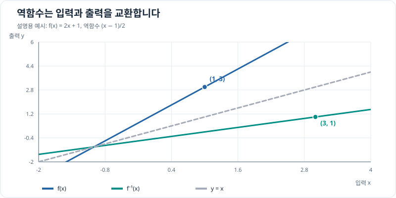

# 단사·전사와 역함수

## 그래프로 이해하기

*전단사 함수의 그래프와 역함수 그래프는 직선 y=x에 대해 대칭입니다. 이 그림은 원리 설명용 일차함수 예시입니다.*

## 단사·전사·전단사

입력 집합 $A$, 출력 대상으로 정한 집합 $B$를 먼저 고정하고 $f:A\to B$라고 씁니다. 실제로 나오는 값들의 집합 $f(A)$는 **치역**, $B$는 **공역**입니다. 공역을 어떻게 정하느냐에 따라 전사 여부가 달라집니다.

| 성질 | 정의 | 입력 복원과의 관계 |
| --- | --- | --- |
| 단사(injective) | $f(x_1)=f(x_2)$이면 $x_1=x_2$ | 한 출력에 서로 다른 입력이 겹치지 않음 |
| 전사(surjective) | 모든 $y\in B$에 대해 $f(x)=y$인 $x\in A$가 있음 | 공역의 모든 값에 도달함 |
| 전단사(bijective) | 단사이면서 전사 | 모든 출력에 대응하는 입력이 정확히 하나임 |

**역함수가 존재할 조건.** $f:A\to B$가 전단사이면 각 $y\in B$를 만드는 유일한 $x\in A$를 $f^{-1}(y)$로 정할 수 있습니다. 반대로 $f^{-1}:B\to A$가 함수이고 $f^{-1}(f(x))=x$, $f(f^{-1}(y))=y$라면 모든 $y$는 도달 가능하여 전사이고, 같은 출력의 역함수값은 하나뿐이므로 단사입니다. 따라서 두 집합 전체에서의 역함수는 전단사일 때, 그리고 그때에만 존재합니다.

$\sin x$는 $\sin 0=\sin 2\pi=0$처럼 서로 다른 입력이 같은 출력을 내므로 $\mathbb R$에서 단사가 아닙니다. $\cos x$도 마찬가지입니다. $\tan x$는 $\pi/2+k\pi$에서 정의되지 않고, 정의되는 전체 구간에서도 주기 $\pi$ 때문에 단사가 아닙니다. 이 삼각함수들을 역으로 쓰려면 입력 범위를 **단조인 한 구간으로 제한**해야 합니다. 이후 공역을 그 구간의 치역으로 정하면 전단사가 됩니다.

## 역함수와 역삼각함수

역함수는 출력으로부터 원래 입력을 찾습니다. 드론의 자세를 추정할 때 각도 $\theta$가 비율 $r=\sin\theta$를 만든다고 해도, 같은 $r$을 만드는 각도는 무수히 많습니다. 센서값만으로 모든 각도를 유일하게 복원할 수 없고, **자세의 가능한 범위** 같은 추가 조건이 필요합니다.

삼각함수의 표준 역함수는 다음처럼 원래 함수를 제한하여 정의합니다.

| 원래 함수의 제한 | 제한한 함수의 치역 | 역함수의 정의와 값 범위 |
| --- | --- | --- |
| $\sin:[-\pi/2,\pi/2]\to[-1,1]$ | $[-1,1]$ | $\arcsin:[-1,1]\to[-\pi/2,\pi/2]$ |
| $\cos:[0,\pi]\to[-1,1]$ | $[-1,1]$ | $\arccos:[-1,1]\to[0,\pi]$ |
| $\tan:(-\pi/2,\pi/2)\to\mathbb R$ | $\mathbb R$ | $\arctan:\mathbb R\to(-\pi/2,\pi/2)$ |

각 구간에서 원래 함수는 연속이고 엄격히 단조입니다. 따라서 단사입니다. 사인과 코사인은 양 끝에서 $-1$과 $1$에 도달하고, 탄젠트는 양 끝으로 갈 때 $-\infty$와 $+\infty$로 발산하므로 표시한 공역에 전사입니다. 이것이 세 역삼각함수의 정의 근거입니다.

**각도 도출.** $y=\arcsin r$은 $r=\sin y$와 $y\in[-\pi/2,\pi/2]$를 동시에 만족하는 유일한 값입니다. $r=1/2$이면 $y=\pi/6=30^\circ$입니다. 같은 방식으로 $\arccos(1/2)=\pi/3=60^\circ$, $\arctan(1)=\pi/4=45^\circ$입니다. $\sin^{-1}r$ 표기는 $\arcsin r$과 같으며, $1/\sin r$을 뜻하지 않습니다.

### 각도와 변화율 구분하기

$\arcsin x$는 비율 $x$에서 **각도**를 구하는 역함수입니다. $1/\sqrt{1-x^2}$는 그 각도 자체가 아니라, 비율을 조금 바꿨을 때 각도가 얼마나 변하는지를 나타내는 **도함수**입니다. 따라서 $y=\arcsin x$일 때 올바른 표기는

\[
y'=\frac{dy}{dx}=\frac{d}{dx}\arcsin x
=\frac{1}{\sqrt{1-x^2}}\qquad(-1<x<1)
\]

입니다. 예를 들어 $x=1/2$에서 역함수값은 $\pi/6$ rad이지만 도함수값은 $2/\sqrt3$ rad/비율입니다. $\arccos x$와 $\arctan x$의 도함수 및 세 공식의 유도는 [역함수의 미분법](../differentiation/inverse-function-derivatives.md#inverse-trig-derivatives)에 이어집니다.

역삼각함수 시뮬레이션: 비율에서 주값 각도 찾기

사인 비율을 바꾸며 제한된 정의역에서 수평선과 그래프의 교점을 살펴보세요. 툴팁은 각도와 사인값을 표시합니다. 이 도구의 각도는 라디안입니다.

<iframe src="../../../../simulations/inverse-trig/index.html?v=calculus-1" title="역삼각함수 시뮬레이터" width="100%" height="640" loading="lazy" style="border: 1px solid #ddd; border-radius: 8px;"></iframe>

<a href="../../../../simulations/inverse-trig/index.html?v=calculus-1" target="_blank" rel="noopener">시뮬레이터 새 창에서 열기</a> · <a href="https://github.com/koosco/applied-science/blob/main/simulations/inverse_trig.py">Python 원본 코드</a>

## 문제 예시: 드론 기울기 추정 범위 확인

드론이 거의 정지한 상태에서 중력 방향을 이용해 얻은 센서 비율을 $r=\sin\theta$로 모델링합니다. 기울기 $\theta$의 허용 범위가 $[-45^\circ,45^\circ]$일 때, $r=0.60$의 기울기를 구하고 $r=0.80$도 같은 허용 범위에서 설명할 수 있는지 판단해 보세요. 센서 축과 기체 좌표계가 맞고 다른 가속도의 영향은 무시합니다.

**풀이.** 허용 각도에서는 사인 함수가 엄격히 증가하므로 각도를 유일하게 찾을 수 있습니다. $\arcsin(0.60)\approx0.644\,\mathrm{rad}\approx36.87^\circ$이고 허용 범위 안입니다. 반면 허용 범위에서 가능한 비율은 $[-\sin45^\circ,\sin45^\circ]=[-\sqrt2/2,\sqrt2/2]\approx[-0.707,0.707]$입니다. $0.80$은 이 치역 밖이므로 **이 범위와 모델을 동시에 만족하는 각도가 없습니다**. 자세 범위를 벗어났거나 가속도·보정 오차가 섞였는지 확인해야 합니다.
