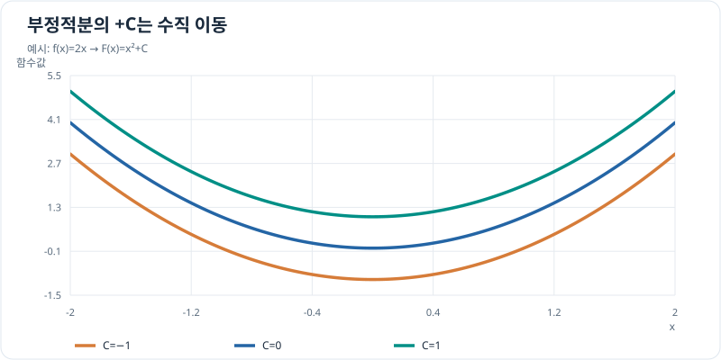

# 부정적분

속도나 각속도처럼 **변화율**을 알고 원래 함수의 식을 찾을 때 부정적분을 사용합니다. 이 단원은 정적분으로 구간의 변화량을 계산하기 전에, 원시함수를 구하는 규칙과 식을 바꾸는 기법을 정리합니다. 결과는 항상 미분해 원래 함수로 돌아오는지 확인합니다.

## 그래프로 이해하기

*같은 함수 f(x)=2x의 원시함수는 F(x)=x²+C처럼 상수 C만큼 수직 이동한 함수들의 가족입니다.*

## 원시함수와 적분상수

구간 $I$에서 $F'(x)=f(x)$이면 $F$를 $f$의 **원시함수(antiderivative)**라고 합니다. 부정적분은 원시함수 하나가 아니라 그 전체 가족입니다.

\[
\int f(x)\,dx=F(x)+C,\qquad C\in\mathbb R.
\]

$F+C$를 미분하면 $f$가 됩니다. 반대로 $F$와 $G$가 같은 구간 $I$에서 모두 $f$의 원시함수라면 $(F-G)'=0$입니다. [평균값 정리](../differentiation/theorems/cauchy-mean-value.md)의 특수한 경우에 따라 $I$의 임의의 두 점에서 $F-G$의 값이 같으므로 두 원시함수는 상수만큼만 다릅니다. **하나로 이어진 구간**이라는 조건이 중요합니다. 예를 들어 $1/x$의 정의역을 $x<0$과 $x>0$으로 나누면 양쪽의 상수를 서로 다르게 정할 수 있습니다.

$dx$는 적분 변수를 표시합니다. $\int f(t)\,dt$를 구할 때는 $t$를 기준으로 미분해 검산합니다. 적분상수 $C$는 초기 위치나 초기 각도처럼 한 시점의 값이 주어져야 결정됩니다.

## 계산 기법을 고르는 순서

| 적분할 식의 모습 | 먼저 확인할 방법 | 문서 |
| --- | --- | --- |
| 다항식·지수함수와 $1/x$ 형태의 합 | 기본 공식과 선형성 | [기본 공식](basic-rules.md) |
| $f(g(x))g'(x)$처럼 안쪽 함수의 도함수가 보임 | 합성함수의 미분을 거꾸로 적용 | [합성함수와 치환적분](substitution.md) |
| 사인·코사인의 거듭제곱이나 곱 | 삼각함수 항등식과 치환 | [삼각함수 적분](trigonometric-integrals.md) |
| 미분하면 단순해지는 함수와 적분하기 쉬운 함수의 곱 | 곱의 미분을 거꾸로 적용 | [부분적분](integration-by-parts.md) |
| 다항식의 비 $P(x)/Q(x)$ | 나눗셈·인수분해·부분분수 | [유리함수 적분](partial-fractions.md) |
| $\sqrt{a^2-x^2}$ 등 이차식의 제곱근 | 삼각 항등식으로 제곱근 제거 | [삼각치환](trigonometric-substitution.md) |

한 적분에 여러 기법을 연달아 쓸 수 있습니다. 예를 들어 삼각함수의 거듭제곱을 항등식으로 바꾼 뒤 치환적분을 할 수 있습니다. 단순한 공식으로 끝나는지 먼저 확인하고, 복잡한 치환은 필요할 때 사용합니다.

## 문제 예시: 각속도에서 방향각 찾기

드론의 한 축에서 측정 오차를 무시한 **가상** 각속도 계획을 $\omega(t)=(0.4+0.2t)\,\mathrm{rad/s}$로 둡니다. $t$는 초 단위 시간의 수치이고 $0\le t\le3$입니다. 시작 각도가 $\theta(0)=0.3\,\mathrm{rad}$일 때 $\theta(t)$와 $\theta(3)$을 구해 보세요.

**풀이.** $\theta'(t)=\omega(t)$이므로 각 항의 원시함수를 구해 $\theta(t)=0.4t+0.1t^2+C$ 라디안으로 씁니다. $\theta(0)=0.3$을 넣으면 $C=0.3$이고, 따라서 $\theta(3)=0.3+1.2+0.9=2.4\,\mathrm{rad}$입니다. 미분하면 다시 $0.4+0.2t$가 나옵니다. 실제 자이로스코프 값을 시간에 따라 누적하면 바이어스와 잡음도 영향을 주므로, 이 결과는 주어진 이상적 모델에만 해당합니다.

## 참고 자료

- [OpenStax Calculus Volume 1, Antiderivatives](https://openstax.org/books/calculus-volume-1/pages/4-10-antiderivatives)
