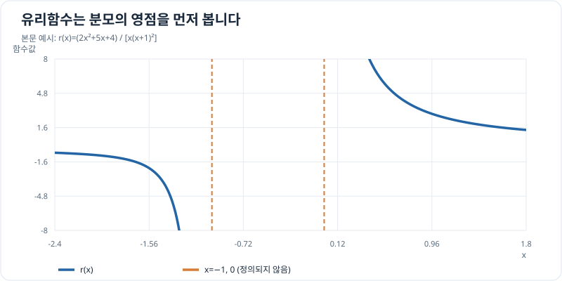

# 유리함수와 부분분수 적분

다항식의 비 $P(x)/Q(x)$는 분모를 인수분해하면 로그나 역탄젠트의 도함수 형태로 나눌 수 있습니다. 이 방법을 **부분분수 분해(partial fractions)**라고 합니다. 유리식으로 표현한 간단한 응답 모델을 원시함수로 바꿀 때 유용하지만, 먼저 정의역과 분모의 영점을 확인해야 합니다.

## 그래프로 이해하기

*본문의 유리함수는 분모가 0이 되는 x=−1과 x=0에서 정의되지 않습니다. 부분분수 적분을 할 때 구간과 로그의 정의역을 구분해야 합니다.*

## 나눗셈과 분모의 인수분해

$P$의 차수가 $Q$ 이상이면 다항식 나눗셈을 먼저 합니다. 예를 들어 $x^2/(x+1)=x-1+1/(x+1)$이므로 다항식 부분과 진분수 부분을 따로 적분할 수 있습니다.

서로 다른 일차 인수라면

\[
\frac{P(x)}{(x-a)(x-b)}=\frac{A}{x-a}+\frac{B}{x-b}
\]

로 두고 양변에 분모를 곱해 계수를 구합니다. 같은 인수가 두 번 나오면 $A/(x-a)+B/(x-a)^2$처럼 **각 차수의 항**을 넣어야 합니다. 실수 범위에서 인수분해되지 않는 $x^2+a^2$ ($a>0$)에는

\[
\int\frac{dx}{x^2+a^2}=\frac1a\arctan\frac xa+C
\]

를 쓸 수 있습니다. 이는 $\frac{d}{dx}\arctan(x/a)=a/(x^2+a^2)$를 확인해 얻습니다. 이차식의 분자에 $x$ 항이 있으면 [치환적분](substitution.md)으로 로그 형태도 살펴봅니다.

## 문제 예시: 반복 인수가 있는 유리식

정규화한 입력 $x>0$에 대한 가상 유리식

\[
r(x)=\frac{2x^2+5x+4}{x(x+1)^2}
\]

의 원시함수를 구해 보세요. 여기서 $x$는 무차원 변수이며, 실제 드론 응답을 측정해 얻은 식은 아닙니다.

**풀이.** 분모에 $x+1$이 두 번 있으므로 세 항을 모두 둡니다.

\[
\frac{2x^2+5x+4}{x(x+1)^2}
=\frac{A}{x}+\frac{B}{x+1}+\frac{D}{(x+1)^2}.
\]

분모를 곱해 정리하면 $2x^2+5x+4=A(x+1)^2+Bx(x+1)+Dx$입니다. 상수항에서 $A=4$, $x^2$항에서 $B=-2$, $x$항에서 $D=-1$입니다. 따라서

\[
\int r(x)\,dx
=4\ln x-2\ln(x+1)+\frac1{x+1}+C\qquad(x>0).
\]

오른쪽을 미분해 통분하면 다시 $r(x)$가 됩니다. $x>0$으로 범위를 정했으므로 로그의 절댓값을 생략했습니다. 다른 연결 구간에서 계산한다면 각 구간의 정의역과 적분상수를 따로 확인해야 합니다.

## 참고 자료

- [OpenStax Calculus Volume 2, Partial Fractions](https://openstax.org/books/calculus-volume-2/pages/3-4-partial-fractions)
