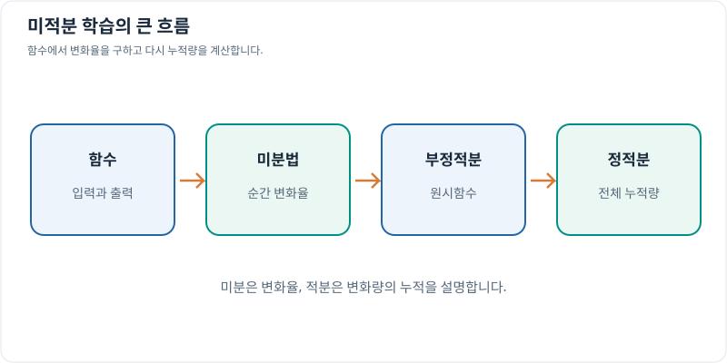

# 미적분 학습 목차

센서값으로 상태를 추정하고 물리량의 변화를 계산하는 데 필요한 내용을 네 단원으로 나눴습니다. 각 단원의 개요에서 학습 순서와 세부 문서를 찾을 수 있습니다.

| 단원 | 핵심 질문 |
| --- | --- |
| [함수](functions/index.md) | 입력과 출력을 연결하고, 역함수의 존재와 극한·연속을 어떻게 판단하는가? |
| [미분법](differentiation/index.md) | 순간 변화율을 계산해 운동·민감도·극값을 어떻게 해석하는가? |
| [부정적분](indefinite-integrals/index.md) | 변화율에서 원시함수를 어떻게 찾고 적분 기법을 선택하는가? |
| [정적분](definite-integrals/index.md) | 변화율을 구간에 걸쳐 누적해 전체 변화량을 어떻게 계산하는가? |

함수의 극한을 이해한 뒤 미분법을 읽고, 미분 공식을 거꾸로 사용하며 부정적분으로 이어갈 수 있습니다. 이후 정적분에서 변화율의 누적과 미적분학의 기본정리를 학습합니다. 필요한 단원부터 시작해도 각 개요에서 선수 지식과 관련 문서를 확인할 수 있습니다.

## 그래프로 이해하기

*입출력 관계를 익힌 뒤 변화율을 계산하고, 원시함수와 정적분으로 누적량을 구하는 학습 순서입니다.*
