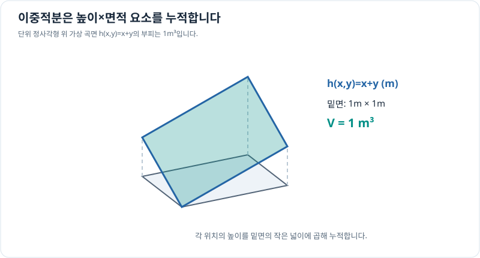

# 이중적분: 평면 전체의 누적량

> 다변수 미적분 8/10 · 선수 지식: 정적분과 2차원 좌표계

## 한 점이 아니라 면적 전체를 더하기

평면 영역 $D$에서 $f(x,y)$의 값을 작은 면적 요소 $dA$에 걸쳐 모두 더하면 **이중적분(double integral)**이 됩니다.

\[
\boxed{\iint_D f(x,y)\,dA}.
\]

직사각형 $D=[a,b]\times[c,d]$에서 연속함수는 다음처럼 반복적분으로 계산할 수 있습니다.

\[
\int_c^d\left(\int_a^b f(x,y)\,dx\right)dy.
\]

$y$를 고정하고 $x$를 먼저 적분한 다음, 그 결과를 $y$에 대해 적분합니다. 함수의 물리량이 면적당 질량이라면 결과는 질량이고, 높이라면 결과는 부피가 됩니다.

## 그래프로 이해하기

*같은 면적이라도 높이가 달라지면 작은 부피가 달라집니다. 전체 부피는 높이와 면적 요소의 곱을 누적합니다.*

## 문제 예시: 변화하는 높이 아래 부피

$x,y$는 각각 m 단위의 좌표 수치로 두고, $0\le x\le1$, $0\le y\le1$인 사각형의 높이를 $h(x,y)=(x+y)$ m로 정의합니다. 이 영역 위의 부피를 계산하세요.

**풀이.** 각 $x,y$의 수치는 m 단위 좌표의 숫자라고 정했습니다.

\[
V=\int_0^1\int_0^1(x+y)\,dx\,dy
=\int_0^1\left(\frac12+y\right)dy
=\frac12+\frac12=1\,\mathrm{m^3}.
\]

높이가 0에서 2m 사이이고 평균 높이는 1m이므로, 넓이 1m²에 평균 높이 1m를 곱한 결과와 일치합니다.

## 확인 문제

단위 정사각형 $D=[0,1]^2$에서 $f(x,y)=2$인 무차원 상수함수의 이중적분을 구하세요.

## 확인 문제 풀이

$\iint_D2\,dA=2\times1=2$입니다. 한 점의 함수값이 아니라 영역 전체에 값을 누적한 결과입니다.

[← 이전: 최적화](multivariable-optimization.md) · [다음: 극좌표 이중적분](polar-double-integrals.md)
