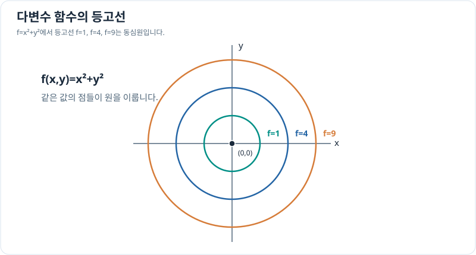

# 다변수 함수와 등고선

> 다변수 미적분 1/10 · 선수 지식: 함수와 좌표계

## 입력이 둘인 함수를 읽는 방법

$f(x,y)$는 입력 두 개 $(x,y)$에서 값 하나를 출력하는 **스칼라 함수**입니다. 정의역은 평면 위의 점들의 집합이며, 그래프 $z=f(x,y)$는 3차원 공간의 곡면이 됩니다. **등고선(level set)** $f(x,y)=c$는 출력이 같은 점들을 평면에 표시합니다.

\[
f(x,y)=x^2+y^2\quad\Longrightarrow\quad f(x,y)=c
\iff x^2+y^2=c.
\]

$c\ge0$에서 등고선은 원점 중심 반지름 $\sqrt c$의 원이고 $c<0$에서는 점이 없습니다.

## 그래프로 이해하기

*같은 함수값은 하나의 점이 아니라 곡선 전체에서 나타날 수 있습니다. 실제 지형 높이 지도도 등고선이라는 개념을 사용합니다.*

## 문제 예시: 위치에 따른 가상 비용 함수

두 무차원 입력 $x,y$가 있을 때 가상 비용을 $C(x,y)=x^2+y^2$라고 가정합니다. $(1,2)$의 비용과 비용이 5인 다른 위치를 찾아 보세요.

**풀이.** $C(1,2)=1+4=5$입니다. $C(x,y)=5$이면 $x^2+y^2=5$이므로 $(2,1)$이나 $(-1,2)$도 비용 5입니다. 값은 같아도 위치는 다를 수 있습니다.

## 확인 문제

$g(x,y)=2x+y^2$일 때 $g(1,2)$와 $g(2,1)$을 비교하세요.

## 확인 문제 풀이

$g(1,2)=2+4=6$, $g(2,1)=4+1=5$입니다. 두 입력을 바꾸는 순서는 일반적으로 중요합니다.

[← 목차](index.md) · [다음: 편미분](partial-derivatives.md)
