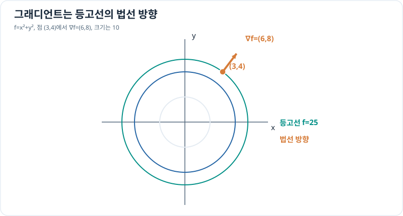

# 그래디언트와 방향도함수

> 다변수 미적분 3/10 · 선수 지식: [편미분](partial-derivatives.md), 벡터·내적

## 특정 방향의 변화율 구하기

다변수 스칼라 함수의 **그래디언트(gradient)**는 편도함수를 모은 벡터입니다.

\[
\nabla f=(f_x,f_y).
\]

$f$가 미분 가능한 점에서 크기 1의 방향벡터 $\mathbf u$로 이동할 때의 순간 변화율은 **방향도함수**

\[
\boxed{D_{\mathbf u}f=\nabla f\cdot\mathbf u}
\]

입니다. 코시–슈바르츠 부등식에 따라 그 최댓값은 $\|\nabla f\|$이며, $\nabla f\ne0$이면 그래디언트 방향에서 달성됩니다. 그래디언트는 등고선에 수직입니다(그래디언트가 0이 아닌 정칙점에서).

## 그래프로 이해하기

*등고선을 가로질러 가장 빠르게 증가하는 방향이 그래디언트입니다.*

## 문제 예시: 같은 위치에서 이동 방향 바꾸기

$f(x,y)=x^2+y^2$, 현재 점은 $(3,4)$이고 이동 방향 단위벡터는 $\mathbf u=(3/5,4/5)$입니다. 방향도함수를 구하고 가능한 최대값과 비교하세요.

**풀이.** $\nabla f(3,4)=(6,8)$이고 크기는 10입니다. 따라서

\[
D_{\mathbf u}f=(6,8)\cdot(3/5,4/5)
=18/5+32/5=10.
\]

$\mathbf u=(6,8)/10$이므로 이 방향은 바로 그래디언트 방향이고 가능한 최대 증가율 10을 얻습니다.

## 확인 문제

같은 점과 함수에서 $\mathbf u=(-4/5,3/5)$ 방향의 변화율은 얼마일까요?

## 확인 문제 풀이

$(6,8)\cdot(-4/5,3/5)=(-24+24)/5=0$입니다. 등고선에 접하는 방향에서는 순간 함수값 변화율이 0입니다.

[← 이전: 편미분](partial-derivatives.md) · [다음: 다변수 연쇄법칙](multivariable-chain-rule.md)
