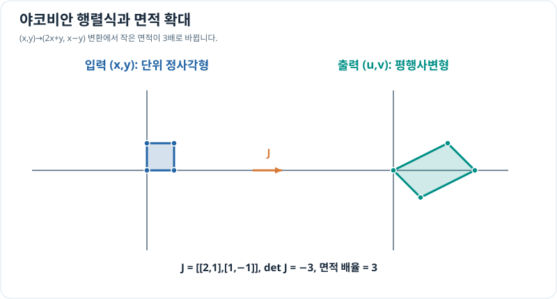

# 야코비안 행렬과 국소 좌표 변환

> 다변수 미적분 6/10 · 선수 지식: 편미분·행렬의 기초

## 여러 입력이 여러 출력으로 바뀌면

벡터값 함수 $\mathbf F(x,y)=(F_1(x,y),F_2(x,y))$의 모든 편도함수를 모은 행렬을 **야코비안 행렬(Jacobian matrix)**이라고 합니다.

\[
J_{\mathbf F}=
\begin{bmatrix}
\partial F_1/\partial x & \partial F_1/\partial y\\
\partial F_2/\partial x & \partial F_2/\partial y
\end{bmatrix}.
\]

점 $\mathbf p$ 근처에서 작은 변화 $\Delta\mathbf p$에 대해

\[
\Delta\mathbf F\approx J_{\mathbf F}(\mathbf p)\Delta\mathbf p.
\]

입력과 출력이 모두 2차원일 때 야코비안 행렬식의 절댓값 $|\det J|$은 **아주 작은 면적 요소의 확대 배율**을 나타냅니다. 행렬식의 부호는 방향 보존/반전을 표현합니다. 0이면 국소적으로 면적이 찌그러져 정규 역변환에 문제가 생길 수 있습니다.

## 그래프로 이해하기

*면적 배율은 행렬식 −3의 **절댓값 3**입니다. 음의 부호가 면적을 음수로 만든다는 뜻은 아닙니다.*

## 문제 예시: 평면 선형변환의 면적 변화

$\mathbf F(x,y)=(2x+y,\ x-y)$로 변환할 때 야코비안과 작은 영역의 면적 배율을 구하세요.

**풀이.** 각 성분을 편미분하면

\[
J=
\begin{bmatrix}
2&1\\
1&-1
\end{bmatrix},\qquad
\det J=2(-1)-1(1)=-3.
\]

따라서 1 단위²의 면적은 3 단위²로 늘어나고, 평면의 방향(orientation)은 반전됩니다. 이는 변환이 선형이므로 작은 영역뿐 아니라 전체 단위 정사각형에서도 정확합니다.

## 확인 문제

변환 $\mathbf G(x,y)=(3x,2y)$의 야코비안과 면적 배율은 얼마일까요?

## 확인 문제 풀이

$J_{\mathbf G}=\operatorname{diag}(3,2)$이며 $\det J=6$이므로 면적 배율은 6입니다.

[← 이전: 접평면](tangent-plane-linearization.md) · [다음: 다변수 최적화](multivariable-optimization.md)
