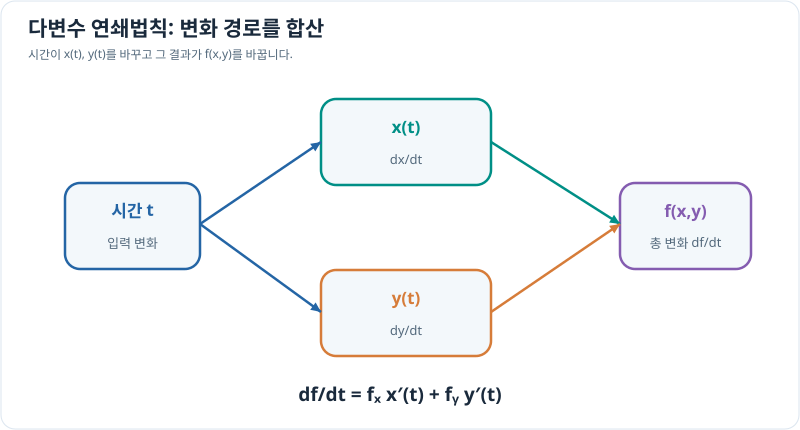

# 다변수 연쇄법칙

> 다변수 미적분 4/10 · 선수 지식: 편미분·연쇄법칙

## 경로 위에서 값이 달라지는 속도

위치 $(x(t),y(t))$가 시간에 따라 바뀌고 값 $f(x,y)$가 위치에 의존하면, 전체 시간 변화율은 두 성분의 영향을 **합산**해야 합니다.

\[
\boxed{\frac{df}{dt}=\frac{\partial f}{\partial x}\frac{dx}{dt}
+\frac{\partial f}{\partial y}\frac{dy}{dt}.}
\]

벡터 표기로는 $df/dt=\nabla f\cdot\mathbf v$입니다. 식의 편도함수는 **현재 경로 위의 점 $(x(t),y(t))$에서 평가**합니다.

## 그래프로 이해하기

*두 경로의 기여를 각각 계산해 더합니다. 어느 한쪽의 변화율만으로는 전체 변화를 설명할 수 없습니다.*

## 문제 예시: 이동하는 점에서 값의 시간 변화율

$x(t)=t$, $y(t)=t^2$, $f(x,y)=x^2+3y$입니다. $t=2$에서 $df/dt$를 두 가지 방식으로 계산하세요. 변수는 무차원 예제입니다.

**풀이.** 직접 대입하면 $f(t,t^2)=t^2+3t^2=4t^2$이므로 $df/dt=8t$이고 $t=2$에서 16입니다.

편미분으로 계산하면

\[
f_x=2x,\quad f_y=3,\quad x'=1,\quad y'=2t,
\]

\[
\frac{df}{dt}=(2t)(1)+3(2t)=8t=16\quad(t=2).
\]

두 방법의 결과가 같으므로 연쇄법칙을 검산할 수 있습니다.

## 확인 문제

$f(x,y)=xy$, $x(t)=t$, $y(t)=2t$일 때 $df/dt$를 구하세요.

## 확인 문제 풀이

$f(t,2t)=2t^2$이므로 $df/dt=4t$입니다. 편미분으로는 $f_x=y$, $f_y=x$이므로 $y(1)+x(2)=2t+2t=4t$가 됩니다.

[← 이전: 그래디언트](gradient-and-directional-derivatives.md) · [다음: 접평면](tangent-plane-linearization.md)
