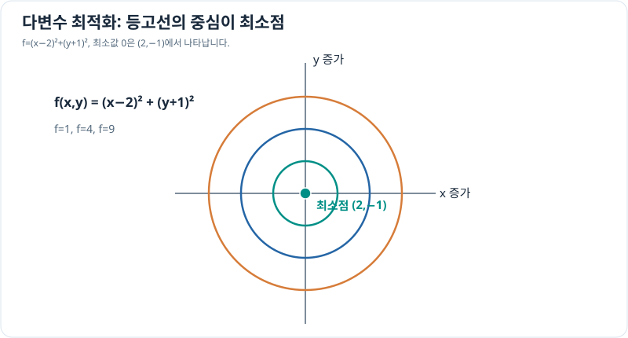

# 다변수 최적화의 기초

> 다변수 미적분 7/10 · 선수 지식: 그래디언트·이계도함수

## 최적점 후보와 곡률

여러 입력에서 미분 가능한 비용 함수 $f(x,y)$의 **내부 국소 극값 후보**는 $\nabla f=0$인 점입니다. 이 조건은 필요조건일 뿐, 안장점(saddle point)도 가능하므로 충분하지 않습니다.

2차 미분을 모은 **헤시안(Hessian)**은

\[
H_f=
\begin{bmatrix}
f_{xx}&f_{xy}\\
f_{yx}&f_{yy}
\end{bmatrix}
\]

입니다. 정지점에서 헤시안이 양의 정부호이면 엄격한 국소 최소, 음의 정부호이면 엄격한 국소 최대입니다. 정부호가 아닌 경우에는 다른 검토가 필요하며, 경계가 있으면 경계에서도 값을 비교해야 합니다.

## 그래프로 이해하기

*중심에서 비용 0을 얻습니다. 한 변수만 최적화해서는 두 입력의 공동 최적점을 보장하지 않습니다.*

## 문제 예시: 두 개의 가상 제어 입력 최소화

비용 $f(x,y)=(x-2)^2+(y+1)^2$를 최소화하세요. $x,y$는 무차원 입력입니다.

**풀이.** 그래디언트를 0으로 두면

\[
f_x=2(x-2)=0,\quad f_y=2(y+1)=0
\]

이므로 후보는 $(2,-1)$입니다. 헤시안은 $\operatorname{diag}(2,2)$로 양의 정부호이고, 제곱합 $f\ge0$이므로 이 점은 전역 최솟값 0도 줍니다.

## 제약조건이 있는 경우

예를 들어 $x+y=2$ 아래에서 $x^2+y^2$를 최소화한다면, $y=2-x$를 대입해 $x^2+(2-x)^2=2(x-1)^2+2$로 바꿀 수 있습니다. 따라서 $(x,y)=(1,1)$에서 최솟값은 2입니다. 더 복잡한 제약에서는 라그랑주 승수법을 사용하며, 이는 후속 최적화 학습의 주제입니다.

## 확인 문제

$f(x,y)=(x+1)^2+(y-3)^2+2$의 전역 최솟값과 위치를 구하세요.

## 확인 문제 풀이

각 제곱항의 최솟값이 0이므로 $(-1,3)$에서 최솟값은 2입니다. 헤시안도 양의 정부호입니다.

[← 이전: 야코비안](jacobian-matrix.md) · [다음: 이중적분](double-integrals.md)
