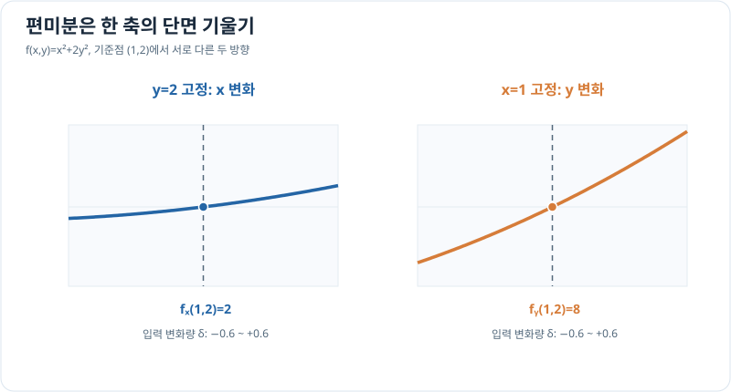

# 편미분: 나머지 입력을 고정하기

> 다변수 미적분 2/10 · 선수 지식: 미분의 기본 규칙

## 하나의 변수를 고정한 변화율

입력이 여러 개인 함수 $f(x,y)$에서는 $y$를 고정하고 $x$만 변할 때의 변화율을 **편도함수** $f_x=\partial f/\partial x$라고 합니다. 반대로 $x$를 고정한 채 $y$만 바꾸면 $f_y$입니다.

\[
f_x(x,y)=\lim_{h\to0}\frac{f(x+h,y)-f(x,y)}{h}.
\]

두 방향의 변화율이 다를 수 있으므로 하나의 기울기로는 모든 방향을 설명하지 못합니다. 이계 편도함수 $f_{xx},f_{xy}$ 등도 정의할 수 있으며, 혼합 편도함수의 순서 교환 $f_{xy}=f_{yx}$에는 예를 들어 주변에서의 연속성과 같은 충분한 조건이 필요합니다.

## 그래프로 이해하기

*한 축을 고정한 단면의 접선 기울기가 편도함수입니다. 이 그림은 두 방향의 변화가 다른 예시입니다.*

## 문제 예시: 두 입력의 비용 민감도

무차원 입력 $x,y$와 비용 $f(x,y)=x^2+2y^2$를 가정합니다. $(1,2)$에서 각 편도함수를 계산해 어떤 입력에 더 민감한지 비교하세요.

**풀이.** $y$를 상수로 두면 $f_x=2x$, $x$를 상수로 두면 $f_y=4y$입니다.

\[
f_x(1,2)=2,\qquad f_y(1,2)=8.
\]

따라서 **같은 크기의 작은 수치 변화**를 각각 가할 때 이 점에서는 $y$ 쪽 변화가 더 큽니다. 서로 단위나 허용 범위가 다른 입력이라면 수치만으로 민감도를 무조건 비교하면 안 됩니다.

## 확인 문제

$f(x,y)=3x^2y+y^3$의 $f_x$, $f_y$를 구하세요.

## 확인 문제 풀이

\[
f_x=6xy,\qquad f_y=3x^2+3y^2.
\]

$f_x$를 구할 때는 $y$를 상수로 취급하므로 $y^3$의 미분값이 0입니다.

[← 이전: 등고선](functions-and-level-sets.md) · [다음: 그래디언트](gradient-and-directional-derivatives.md)
