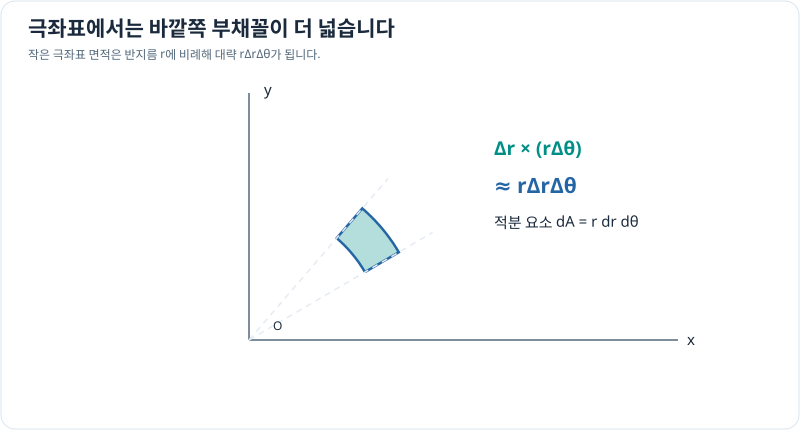

# 극좌표 이중적분과 야코비안

> 다변수 미적분 9/10 · 선수 지식: [좌표 변환](../../coordinate-systems/coordinate-conversion.md), [야코비안](jacobian-matrix.md), 이중적분

## 왜 dx dy 대신 r dr dθ가 될까?

직교좌표와 극좌표 사이의 변환은

\[
x=r\cos\theta,\qquad y=r\sin\theta.
\]

반지름이 $dr$만큼, 각도가 $d\theta$만큼 변하는 작은 부채꼴은 너비가 약 $dr$, 호 길이가 약 $r\,d\theta$입니다. 따라서 면적은 약 $r\,dr\,d\theta$이며, 정확하게는 좌표 변환의 야코비안 절댓값이 $r$입니다.

\[
\boxed{dA=r\,dr\,d\theta.}
\]

극좌표로 바꿀 때 **함수와 영역뿐 아니라 면적 요소도 바꿔야** 합니다. $r\ge0$이고 각도 구간은 영역을 중복 없이 덮도록 선택합니다.

## 그래프로 이해하기

*중심에서 멀수록 같은 각도 폭이 더 큰 호 길이를 만들어 면적 요소가 커집니다.*

## 문제 예시: 반지름 2m 원의 넓이

반지름 2m의 원판 $D$에 대해 $\iint_D1\,dA$를 극좌표로 계산하세요.

**풀이.** 원판을 $0\le r\le2$, $0\le\theta\le2\pi$로 나타냅니다.

\[
A=\int_0^{2\pi}\int_0^2 r\,dr\,d\theta
=\int_0^{2\pi}\left[\frac{r^2}{2}\right]_0^2d\theta
=\int_0^{2\pi}2\,d\theta
=4\pi\,\mathrm{m^2}.
\]

기존 원의 넓이 공식 $\pi(2)^2$와 같습니다.

## 확인 문제

반지름 1m의 반원판 $y\ge0$의 넓이를 극좌표로 구하세요.

## 확인 문제 풀이

$0\le r\le1$, $0\le\theta\le\pi$이므로

\[
A=\int_0^\pi\int_0^1r\,dr\,d\theta=\frac\pi2\,\mathrm{m^2}.
\]

[← 이전: 이중적분](double-integrals.md) · [다음: 삼중적분](triple-integrals.md)
