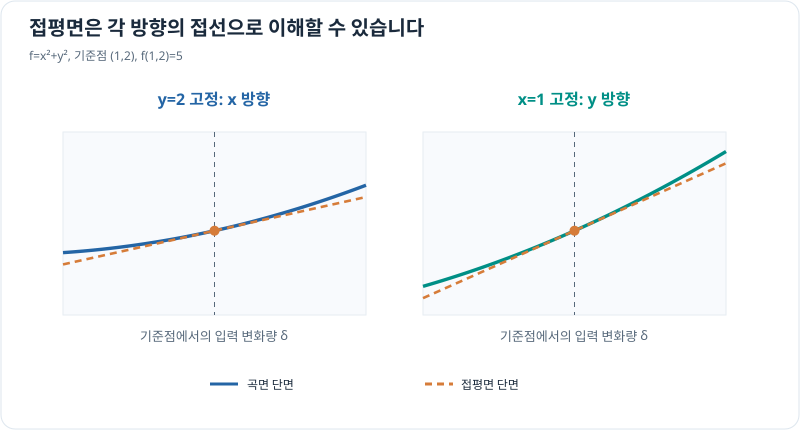

# 접평면과 다변수 선형화

> 다변수 미적분 5/10 · 선수 지식: 그래디언트·선형 근사

## 접선이 아니라 접평면

$f(x,y)$가 $(a,b)$에서 미분 가능하면 작은 입력 변화 $(\Delta x,\Delta y)$에 대해

\[
\boxed{
L(x,y)=f(a,b)+f_x(a,b)(x-a)+f_y(a,b)(y-b)
}
\]

로 근사할 수 있습니다. 그래프 $z=f(x,y)$의 해당 점에서 이 식은 **접평면(tangent plane)**을 나타냅니다. 오차는 입력 이동 벡터의 길이에 비해 충분히 작아집니다. 편도함수가 존재하기만 한다고 항상 모든 방향에서 미분 가능한 것은 아니므로 **미분 가능성**이 핵심 조건입니다.

## 그래프로 이해하기

*접평면은 현재 점의 값과 두 편미분을 모두 반영합니다. 멀어지면 곡면과의 차이가 커집니다.*

## 문제 예시: 두 입력이 동시에 바뀌는 함수값 근사

$f(x,y)=x^2+y^2$를 $(a,b)=(1,2)$에서 선형 근사하고, $(1.1,1.9)$에서의 값과 비교하세요.

**풀이.** $f(1,2)=5$, $f_x=2x$, $f_y=2y$이므로 이 점에서 기울기 성분은 $(2,4)$입니다.

\[
L(x,y)=5+2(x-1)+4(y-2).
\]

$(1.1,1.9)$에서는 $L=5+0.2-0.4=4.8$입니다. 정확한 값은 $1.1^2+1.9^2=1.21+3.61=4.82$이므로 오차는 $0.02$입니다.

## 확인 문제

$f(x,y)=xy$를 $(1,2)$에서 선형 근사한 뒤 $(1.1,2.1)$의 값을 예측하세요.

## 확인 문제 풀이

기준값 $f=2$이고 $f_x=y=2$, $f_y=x=1$입니다.

\[
L(1.1,2.1)=2+2(0.1)+1(0.1)=2.3.
\]

정확한 값은 $1.1(2.1)=2.31$이므로 오차는 0.01입니다.

[← 이전: 다변수 연쇄법칙](multivariable-chain-rule.md) · [다음: 야코비안](jacobian-matrix.md)
