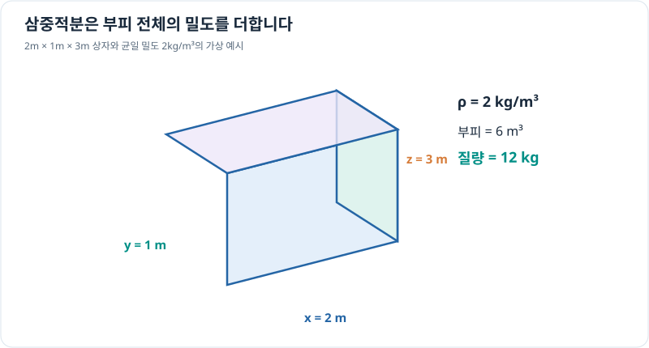

# 삼중적분: 공간에 퍼진 물리량 누적

> 다변수 미적분 10/10 · 선수 지식: 이중적분과 3차원 좌표계

## 3차원 공간의 작은 부피 더하기

공간 영역 $\Omega$에서 밀도 $\rho(x,y,z)$가 주어졌다면 작은 부피 $dV$에 포함된 질량은 대략 $\rho\,dV$입니다. 이를 누적하면 전체 질량을 얻습니다.

\[
\boxed{M=\iiint_\Omega\rho(x,y,z)\,dV}.
\]

직교좌표에서 작은 부피 요소는 $dV=dx\,dy\,dz$입니다. 영역이 직육면체라면 각 좌표 범위에 대한 반복적분으로 계산합니다. 밀도 단위 kg/m³에 부피 m³을 곱하면 결과는 kg입니다.

## 그래프로 이해하기

*공간의 작은 셀을 모두 더하는 것이 삼중적분이며, 균일한 밀도에서는 밀도×부피와 같습니다.*

## 문제 예시: 균일한 밀도 물체의 질량

영역은 $0\le x\le2$ m, $0\le y\le1$ m, $0\le z\le3$ m인 직육면체이며 밀도는 $\rho=2\,\mathrm{kg/m^3}$로 일정합니다. 전체 질량을 계산하세요.

**풀이.** 직육면체의 부피는 $2\times1\times3=6\,\mathrm{m^3}$입니다.

\[
M=\int_0^3\int_0^1\int_0^2 2\,dx\,dy\,dz
=2(2)(1)(3)=12\,\mathrm{kg}.
\]

적분 결과와 밀도×부피 계산이 일치합니다. 실제 밀도가 위치에 따라 변하면 상수 밀도 대신 $\rho(x,y,z)$를 적분해야 합니다.

## 확인 문제

한 변의 길이가 2m인 정육면체의 밀도가 3kg/m³로 일정하다면 질량은 얼마일까요?

## 확인 문제 풀이

부피는 $2^3=8$ m³이고 질량은 $3\times8=24$ kg입니다.

[← 이전: 극좌표 이중적분](polar-double-integrals.md) · [다변수 단원 목차](index.md) · [다음: 벡터 미적분](../vector-calculus/index.md)
