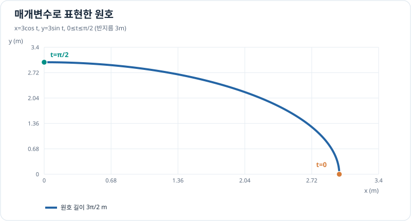

# 매개변수 곡선과 극좌표 미적분

직교좌표에서 $y=f(x)$ 꼴만으로 표현하기 어려운 **궤적**은 시간 $t$ 또는 별도 매개변수로 나타낼 수 있습니다. [벡터와 좌표계](../../coordinate-systems/index.md)에서 위치를 표현했다면, 여기서는 그 위치를 **미분하고 길이·면적을 적분**합니다.

## 순서와 범위

| 순서 | 학습 | 무엇을 계산하는가? |
| --- | --- | --- |
| 1 | [매개변수 곡선의 미분](parametric-derivatives.md) | 시간에 따른 접선·속도·가속도 |
| 2 | [호의 길이](arc-length.md) | 직선이 아닌 경로를 따라 움직인 길이 |
| 3 | [극좌표 곡선과 넓이](polar-curves-and-area.md) | 원점을 기준으로 각도 범위가 쓸고 지나간 넓이 |

## 그래프로 이해하기

*같은 궤적을 $x(t),y(t)$로 나타내면 진행 순서와 변화율을 계산할 수 있습니다.*

## 학습 깊이

필수는 궤적의 속도와 호의 길이입니다. 극좌표 곡선 넓이는 [이중적분의 극좌표 변환](../multivariable/polar-double-integrals.md)을 이해하기 전의 직관적 준비로 공부합니다. 더 복잡한 곡률·프레네 좌표계 공식과 매개변수 표면의 미분기하는 추후에 필요할 때 확장합니다.

[← 근사·급수](../approximations/index.md) · [다음: 매개변수 미분](parametric-derivatives.md)
