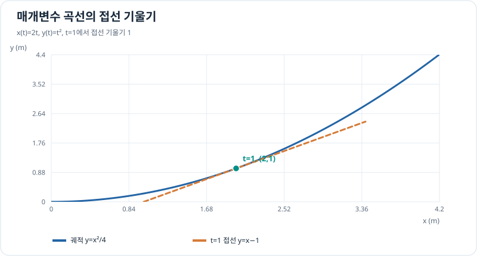

# 매개변수 곡선의 접선과 미분

> 매개변수 곡선 1/3 · 선수 지식: 연쇄법칙, 벡터 성분

## 시간에 따라 좌표가 함께 변할 때

평면 궤적을 $\mathbf r(t)=(x(t),y(t))$로 쓰면 속도·가속도는 각 성분을 시간에 대해 미분한 벡터입니다.

\[
\mathbf v(t)=(x'(t),y'(t)),\qquad
\mathbf a(t)=(x''(t),y''(t)).
\]

$x'(t)\ne0$이면 매개변수의 연쇄법칙으로 궤적의 **접선 기울기**는

\[
\boxed{\frac{dy}{dx}=\frac{dy/dt}{dx/dt}}
\]

입니다. $x'(t)=0$에서는 이 비율을 곧바로 사용할 수 없으며, 수직 접선 여부를 따로 확인해야 합니다. 접선의 **방향벡터**는 $(x',y')$이고 속력은 $\sqrt{x'^2+y'^2}$입니다.

## 그래프로 이해하기

*점 $(2,1)$의 접선은 $dy/dx=1$입니다. 그래프의 기울기 1과 속력 $\sqrt8$은 서로 다른 물리량입니다.*

## 문제 예시: 가상 평면 이동의 방향과 속력

$t\ge0$에서 $x(t)=2t$ m, $y(t)=t^2$ m라는 가상 이동을 가정합니다. $t=1$초에서 위치, 속도, 속력, 접선 기울기를 구하세요. $t$는 초 단위 수치입니다.

**풀이.** 위치는 $(2,1)$ m이고 속도는 $(2,2)$ m/s입니다. 따라서

\[
|\mathbf v(1)|=\sqrt{2^2+2^2}=2\sqrt2\,\mathrm{m/s},
\qquad
\left.\frac{dy}{dx}\right|_{t=1}=\frac{2}{2}=1.
\]

가속도는 $(0,2)$ m/s²입니다. 속도와 가속도가 모두 2차원 벡터이고, **속력이 일정하다는 뜻은 아닙니다.**

## 확인 문제

$x(t)=3t$, $y(t)=t^2$인 궤적에서 $t=2$일 때 $dy/dx$를 구해 보세요.

## 확인 문제 풀이

$x'=3$, $y'=2t$이므로 $t=2$에서 접선 기울기는 $4/3$입니다.

[← 목차](index.md) · [다음: 호의 길이](arc-length.md)
