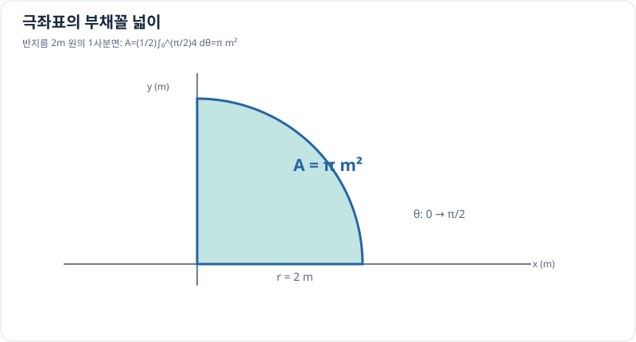

# 극좌표 곡선이 쓸고 지나가는 넓이

> 매개변수 곡선 3/3 · 선수 지식: [극좌표계](../../coordinate-systems/polar-coordinates.md), 정적분

## 반지름과 각도로 면적 계산하기

반지름 $r(\theta)\ge0$가 각도 $\theta$에 따라 변하는 극좌표 곡선을 생각합니다. 매우 작은 각도 $d\theta$에서 부채꼴의 넓이는 약 $\tfrac12r^2d\theta$입니다. 따라서 곡선과 원점 사이의 부채꼴 영역이 **중복 없이** 쓸리는 구간에서는

\[
\boxed{A=\frac12\int_\alpha^\beta r(\theta)^2\,d\theta.}
\]

각도는 라디안입니다. 곡선이 겹치거나 자기 교차하면 같은 영역을 중복 집계할 수 있으므로 구간을 나누어 검토해야 합니다.

## 그래프로 이해하기

*반지름 2m, 각도 90°의 부채꼴 넓이는 $\pi$ m²입니다.*

## 문제 예시: 일정한 반지름의 회전 영역

$r(\theta)=2$ m, $0\le\theta\le\pi/2$인 부채꼴의 넓이를 구하세요.

**풀이.**

\[
A=\frac12\int_0^{\pi/2}(2)^2d\theta
=2\left[\theta\right]_0^{\pi/2}
=\pi\,\mathrm{m^2}.
\]

원의 전체 넓이 $4\pi$ m²의 4분의 1과 일치합니다.

## 확인 문제

$r=3$ m, $0\le\theta\le\pi$인 반원의 넓이를 위 공식으로 구해 보세요.

## 확인 문제 풀이

$A=\tfrac12\cdot9\cdot\pi=9\pi/2$ m²로 전체 원 넓이 $9\pi$ m²의 절반입니다.

[← 이전: 호의 길이](arc-length.md) · [단원 목차](index.md) · [다음: 다변수 미적분](../multivariable/index.md)
