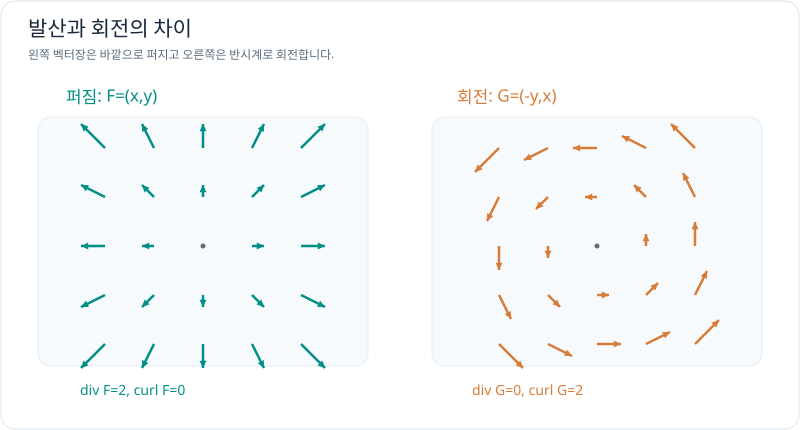

# 발산과 회전: 퍼짐과 소용돌이

> 벡터 미적분 4/5 · 선수 지식: 편미분과 벡터장

## 발산과 회전은 다른 정보다

2차원 벡터장 $\mathbf F=(P,Q)$에서 **발산(divergence)**은 한 점 주변의 순유출 경향을 나타냅니다.

\[
\boxed{\nabla\cdot\mathbf F=P_x+Q_y}.
\]

**회전(curl)**의 평면 수직 성분은 주변의 국소 순환 경향을 나타냅니다.

\[
\boxed{(\nabla\times\mathbf F)_z=Q_x-P_y}.
\]

발산은 '밖으로 퍼짐', 회전은 '국소적으로 빙글 도는 성분'에 대응합니다. 값만 보고 개별 입자의 실제 궤적을 단정하지는 않습니다.

## 그래프로 이해하기

*왼쪽은 양의 발산, 오른쪽은 양의 회전 성분을 갖습니다.*

## 문제 예시: 두 벡터장의 발산과 회전 비교

$\mathbf F=(x,y)$, $\mathbf G=(-y,x)$의 발산과 평면 회전 성분을 계산해 보세요.

**풀이.** 각각 편미분하면

\[
\nabla\cdot\mathbf F=\frac{\partial x}{\partial x}
+\frac{\partial y}{\partial y}=1+1=2,
\qquad
(\nabla\times\mathbf F)_z=0-0=0.
\]

\[
\nabla\cdot\mathbf G=0+0=0,
\qquad
(\nabla\times\mathbf G)_z=1-(-1)=2.
\]

따라서 $\mathbf F$는 퍼지는 모양, $\mathbf G$는 회전하는 모양을 가집니다. 두 계산 모두 무차원 수학적 예시입니다.

## 확인 문제

일정한 벡터장 $\mathbf H=(2,3)$의 발산과 회전 성분은 얼마일까요?

## 확인 문제 풀이

모든 공간 편도함수가 0이므로 발산과 회전 성분 모두 0입니다. **벡터 크기가 0이라는 뜻은 아닙니다.**

[← 이전: 보존장](conservative-fields.md) · [다음: 유량과 적분정리](flux-and-theorems.md)
