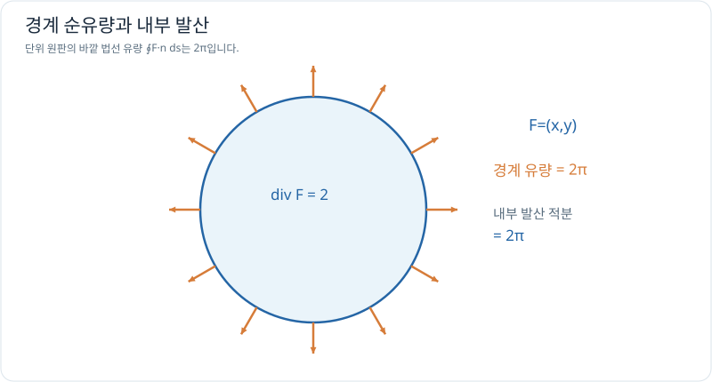

# 유량과 적분정리 입문

> 벡터 미적분 5/5 · 선수 지식: [발산](divergence-and-curl.md), 선적분과 면적

## 경계를 통과하는 벡터장의 양

평면에서 폐곡선 경계 $C$의 바깥쪽 단위 법선을 $\mathbf n$이라 하면 **유량(flux)**은

\[
\boxed{\oint_C\mathbf F\cdot\mathbf n\,ds}
\]

입니다. 법선 방향으로 경계를 가로지르는 성분만 더하며, 바깥으로 향하면 양수, 안으로 향하면 음수가 됩니다.

적절한 매끄러움 조건과 영역에 대해 2차원 발산정리(Green 정리의 유량 형태)는

\[
\oint_{\partial D}\mathbf F\cdot\mathbf n\,ds
=\iint_D \nabla\cdot\mathbf F\,dA
\]

라고 말합니다. **경계를 통한 총 순유출 = 내부 발산의 면적 누적**이라는 뜻입니다.

## 그래프로 이해하기

*원 안의 발산을 모두 더한 값은 원 경계에서 바깥쪽으로 빠져나가는 총 유량과 같습니다.*

## 문제 예시: 단위 원판의 유량 검산

무차원 벡터장 $\mathbf F(x,y)=(x,y)$와 반지름 1 원판을 생각합니다. 경계의 바깥쪽 유량과 내부 발산 적분을 비교하세요.

**풀이.** 경계를 $(\cos\theta,\sin\theta)$로 두면 법선도 $(\cos\theta,\sin\theta)$이고 $ds=d\theta$입니다. 따라서 $\mathbf F\cdot\mathbf n=1$이며

\[
\oint_C\mathbf F\cdot\mathbf n\,ds
=\int_0^{2\pi}1\,d\theta=2\pi.
\]

한편 $\nabla\cdot\mathbf F=2$이고 원의 넓이는 $\pi$이므로 $\iint_D2\,dA=2\pi$입니다. 두 방법이 일치합니다.

## 확인 문제

발산이 3으로 일정한 벡터장이 넓이 2인 영역에 있다고 합시다. 발산정리를 사용할 조건이 충족된다면 경계의 순유량은 얼마인가요?

## 확인 문제 풀이

$\iint_D3\,dA=3\times2=6$입니다. 양수이므로 바깥 방향의 순유량이 양수입니다.

## 다음에 연결할 학습

3차원 Gauss의 발산정리, Stokes의 정리, 복잡한 곡면 적분, 물리적 회전장·전자기장 해석은 **전자기학과 유체역학에서 필요한 만큼** 확장합니다. 지금은 내부와 경계를 적분으로 연결하는 의미를 이해하면 충분합니다.

[← 이전: 발산과 회전](divergence-and-curl.md) · [단원 목차](index.md) · [미적분 전체 목차](../index.md)
