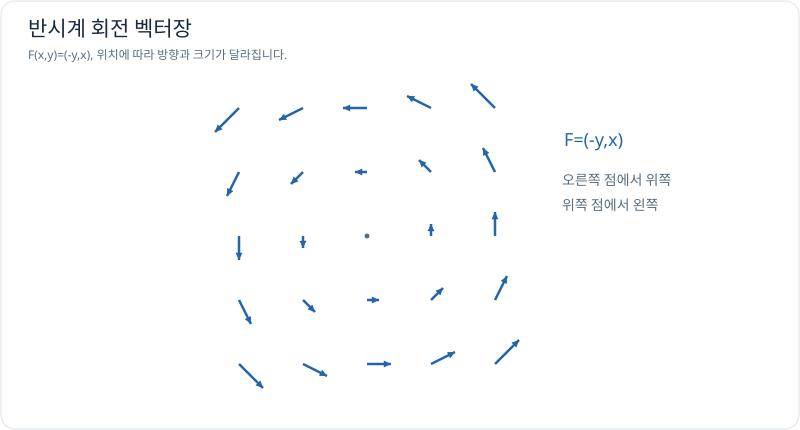

# 벡터 미적분: 장과 적분

다변수 함수가 값 하나를 출력한다면 **벡터장(vector field)**은 공간의 각 점에 벡터를 하나씩 대응시킵니다. 속도장, 힘장, 전기장과 유체 흐름 등을 수학적으로 표현할 때 필요합니다.

## 학습 순서

| 순서 | 문서 | 이해할 질문 |
| --- | --- | --- |
| 1 | [벡터장](vector-fields.md) | 공간의 각 지점에서 방향과 크기가 어떻게 달라지는가? |
| 2 | [선적분과 일](line-integrals.md) | 경로에 따른 힘의 일을 어떻게 누적하는가? |
| 3 | [보존장과 퍼텐셜](conservative-fields.md) | 어떤 경우 경로가 달라도 적분값이 같은가? |
| 4 | [발산과 회전](divergence-and-curl.md) | 흐름이 퍼지는 정도와 회전하는 정도는 어떻게 다른가? |
| 5 | [유량과 적분정리 입문](flux-and-theorems.md) | 경계를 통과하는 양과 내부의 발산이 왜 연결되는가? |

## 그래프로 이해하기

*각 점의 화살표는 그 위치에서의 벡터를 나타냅니다. 화살표 하나는 경로가 아니라 장의 국소적인 값입니다.*

## 범위와 주의사항

**필수:** 벡터장, 선적분의 물리적 의미, 보존장의 경로 독립성. **권장:** 발산·회전·유량의 직관과 단순 계산. Green·Stokes·Gauss 정리의 고난도 곡면 적분과 엄밀한 증명은 전자기학·유체역학을 공부할 때 이어갑니다.

**선수 지식:** [벡터와 좌표계](../../coordinate-systems/index.md), [다변수 미적분](../multivariable/index.md).

[← 다변수 미적분](../multivariable/index.md) · [첫 학습: 벡터장](vector-fields.md)
