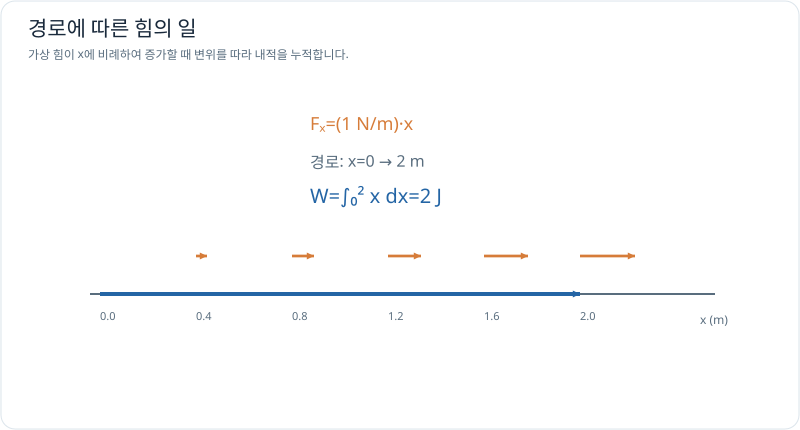

# 선적분: 경로를 따라 누적하기

> 벡터 미적분 2/5 · 선수 지식: 매개변수 곡선과 정적분

## 선적분은 왜 방향을 고려할까?

힘 $\mathbf F$에 의해 경로 $C$를 따라 이동할 때 **일(work)**은 힘과 순간 변위의 내적을 누적한 것입니다.

\[
\boxed{W=\int_C \mathbf F\cdot d\mathbf r}.
\]

경로를 $\mathbf r(t)$, $a\le t\le b$로 매개변수화하면

\[
W=\int_a^b \mathbf F(\mathbf r(t))\cdot\mathbf r'(t)\,dt.
\]

힘과 이동 방향이 나란하면 양의 일이 되고, 반대 방향이면 음의 일이 됩니다. 일반적으로 경로의 모양에 따라 적분값이 달라질 수 있습니다.

## 그래프로 이해하기

*오른쪽으로 갈수록 힘이 커지는 가상 모델입니다. 힘과 미소 이동의 내적을 누적해 일을 얻습니다.*

## 문제 예시: 위치에 따라 커지는 힘의 일

$x$를 m 단위 좌표라 하고 힘 $\mathbf F(x,y)=((1\,\mathrm{N/m})x,0)$이라고 가정합니다. 원점에서 $(2,0)$ m까지 직선으로 이동할 때 힘이 한 일을 계산하세요.

**풀이.** 경로를 $\mathbf r(t)=(t,0)$ m, $0\le t\le2$로 쓰되 $t$는 m 단위의 경로 매개변수 수치라고 둡니다. 그러면 수치적으로 $\mathbf r'=(1,0)$이며

\[
W=\int_0^2 t\,dt=2\,\mathrm J.
\]

단위로 확인하면 힘 N×변위 m=J입니다. 중력이나 실제 모터 힘을 나타내는 것이 아닌 가상 힘장입니다.

## 확인 문제

일정한 힘 $\mathbf F=(3,0)$ N으로 $(0,0)$ m에서 $(0,2)$ m까지 수직 이동할 때 한 일을 구하세요.

## 확인 문제 풀이

힘과 변위가 수직이므로 내적은 0이며 $W=0$ J입니다. 이동 거리가 2m여도 힘이 그 방향으로 한 일은 0입니다.

[← 이전: 벡터장](vector-fields.md) · [다음: 보존장](conservative-fields.md)
