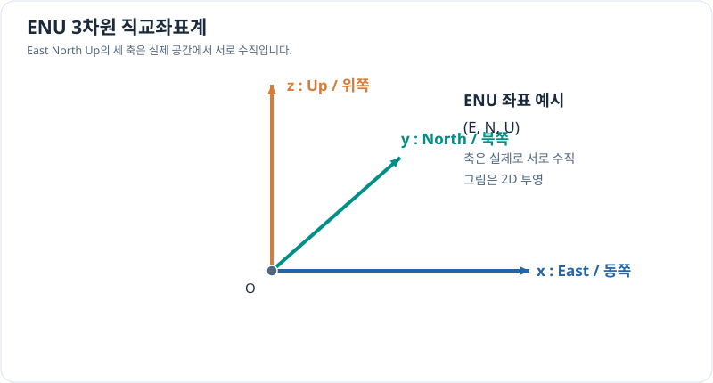

# 3차원 직교좌표계

> 벡터와 좌표계 6/7 · 약 25~35분 · 선수 지식: [2차원 직교좌표계](cartesian-plane.md)

## 2차원에서 3차원으로

3차원 공간에서는 서로 수직인 세 축을 사용하여 점을 $(x,y,z)$로 나타냅니다. 위치벡터와 크기는

\[
\mathbf r=(x,y,z),\qquad
\|\mathbf r\|=\sqrt{x^2+y^2+z^2}.
\]

예시로 **ENU(East–North–Up)** 좌표계를 선택하면 $x$는 동쪽, $y$는 북쪽, $z$는 위쪽을 나타냅니다. 그러나 모든 시스템이 ENU를 사용하는 것은 아닙니다. 드론과 항법에서는 **NED(North–East–Down)**도 쓰이므로 축 이름과 방향을 먼저 확인해야 합니다.

## 그림으로 이해하기

*그림은 ENU 축의 개념적인 2차원 투영입니다. 실제 3차원에서 세 축은 서로 수직이며, 화면상 각도는 투영 때문에 달라 보일 수 있습니다.*

## 문제 예시: 공간 속 두 지점의 변위

ENU 좌표계에서 기준점 $O=(0,0,0)$ m로부터 물체가 $(3,4,12)$ m 위치에 있습니다. 기준점까지의 직선 거리와 각 축 방향 이동량을 구해 보세요.

**풀이.**

\[
\mathbf r=(3,4,12)\,\mathrm m,\qquad
\|\mathbf r\|=\sqrt{3^2+4^2+12^2}
=\sqrt{169}=13\,\mathrm m.
\]

동쪽 3m, 북쪽 4m, 위쪽 12m 위치입니다. 실제 비행 경로가 이 직선과 다르면 경로의 총 길이는 13m보다 길 수 있습니다.

## 좌표계 변환의 필요성

ENU와 NED는 단순히 기호만 다른 것이 아니라 축의 순서와 위·아래 방향이 다릅니다. 같은 원점과 축 정렬을 사용한다면

\[
(x_{\mathrm{ENU}},y_{\mathrm{ENU}},z_{\mathrm{ENU}})
=(E,N,U),
\]

\[
(x_{\mathrm{NED}},y_{\mathrm{NED}},z_{\mathrm{NED}})
=(N,E,-U)
\]

입니다. 실제 지도 기준점이나 좌표계 정의가 다르면 원점 이동 등 추가 변환이 필요합니다.

## 확인 문제

ENU 좌표에서 $A=(1,2,3)$ m, $B=(4,6,15)$ m일 때 $A$에서 $B$로 가는 변위와 직선 거리를 구하세요.

## 확인 문제 풀이

\[
B-A=(3,4,12)\,\mathrm m,\qquad\|B-A\|=13\,\mathrm m.
\]

**다음:** [기준 좌표계와 회전](reference-frames.md) · [이전](polar-motion.md)
