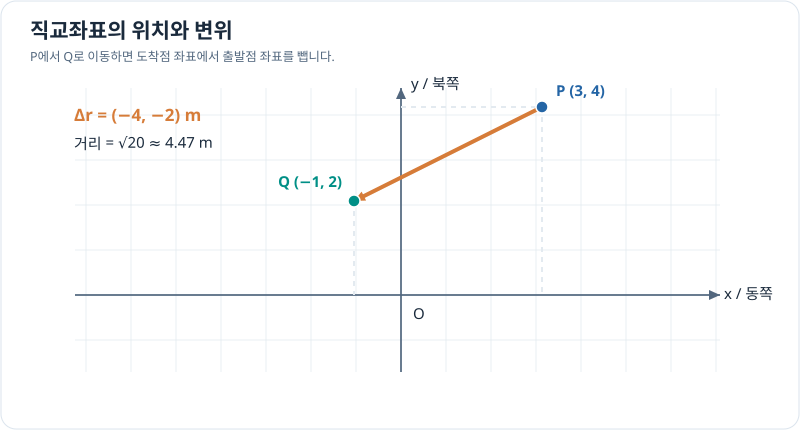

# 2차원 직교좌표계

> 벡터와 좌표계 2/7 · 약 25~35분 · 선수 지식: [벡터와 성분](vectors-and-components.md)

## 위치 좌표와 이동 벡터는 다르다

**직교좌표계(Cartesian coordinates)**는 서로 수직인 축과 원점을 기준으로 위치를 $(x,y)$로 나타냅니다. 축을 동쪽과 북쪽으로 두는 것은 하나의 약속입니다.

위치 $P=(3,4)$ m는 원점에서의 위치이며, 두 점 $P,Q$ 사이의 변위는

\[
\Delta\mathbf r=Q-P=(x_Q-x_P,\;y_Q-y_P)
\]

입니다. 같은 기준 좌표계에서 원점을 평행이동해도 두 점 사이의 변위는 변하지 않습니다.

## 그래프로 이해하기

*점은 위치를, P에서 Q로 향하는 화살표는 변위를 나타냅니다.*

## 문제 예시: 두 좌표 사이의 직선 거리

$P=(3,4)$ m, $Q=(-1,2)$ m일 때 변위와 직선 거리를 구해 보세요. 장애물이 없다고 가정합니다.

**풀이.**

\[
\Delta\mathbf r=Q-P=(-4,-2)\,\mathrm m,
\]

\[
d=\sqrt{(-4)^2+(-2)^2}=2\sqrt5\,\mathrm m\approx4.47\,\mathrm m.
\]

변위는 방향을 포함하지만 거리는 양수입니다. 실제 경로가 굽어 있다면 이동 거리는 이 직선 거리보다 길거나 같습니다.

## 확인 문제

시작점 $A=(-2,1)$ m, 도착점 $B=(1,5)$ m일 때 변위와 직선 거리를 구하세요.

## 확인 문제 풀이

\[
B-A=(3,4)\,\mathrm m,\qquad d=5\,\mathrm m.
\]

**다음:** [극좌표계](polar-coordinates.md) · [이전](vectors-and-components.md)
