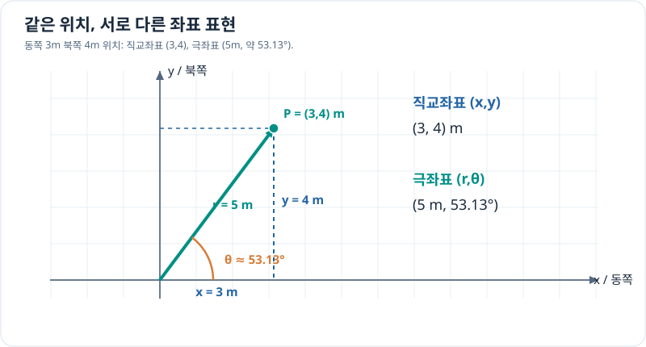

# 벡터와 좌표계 — 학습 개요

정적분에서 물리량의 변화와 누적을 배웠다면, 이제 **위치·이동·방향을 일관된 숫자로 표현**하는 방법을 학습합니다. 직교좌표와 극좌표는 같은 점을 서로 다른 변수로 나타내며, 3차원 공간에서는 기준 좌표계까지 정확히 구분해야 합니다.

이 단원은 미적분학의 하위 주제보다는 **공학 수학의 벡터·좌표 기초**에 해당합니다. [정적분 단원](../calculus/definite-integrals/index.md) 다음으로 이어 읽을 수 있습니다.

## 이 단원의 목표

- 벡터의 크기와 성분을 계산하고 **위치와 변위**를 구별합니다.
- 2차원 직교좌표 $(x,y)$와 극좌표 $(r,\theta)$로 같은 점을 표현합니다.
- 두 좌표계 사이의 변환에서 각도의 기준, 단위, 사분면을 올바르게 다룹니다.
- 반지름·각도가 변할 때의 운동을 살펴본 뒤 3차원 좌표와 기체 좌표계로 확장합니다.

## 권장 학습 순서

| 순서 | 문서 | 핵심 질문 | 중요도 |
| --- | --- | --- | --- |
| 1 | [벡터와 성분 분해](vectors-and-components.md) | 크기와 방향을 두 성분으로 어떻게 나타내는가? | 필수 |
| 2 | [2차원 직교좌표계](cartesian-plane.md) | 좌표와 실제 이동량은 어떻게 다른가? | 필수 |
| 3 | [극좌표계](polar-coordinates.md) | 거리와 각도로 점을 어떻게 표현하는가? | 필수 |
| 4 | [직교·극좌표 변환](coordinate-conversion.md) | 양방향 변환과 사분면을 어떻게 처리하는가? | 필수 |
| 5 | [극좌표에서의 운동](polar-motion.md) | 반지름과 방향이 변하면 속도는 무엇인가? | 권장 |
| 6 | [3차원 직교좌표계](cartesian-3d.md) | 공간 위치와 좌표축을 어떻게 정하는가? | 필수 |
| 7 | [기준 좌표계와 회전](reference-frames.md) | 지면 기준과 기체 기준의 방향을 어떻게 연결하는가? | 후속 입문 |

기본 개념 중심으로 약 **4~6시간**을 권장합니다. 각 페이지에는 예제와 확인 문제를 넣었습니다. **학습 자료가 만들어진 것과 학습을 완료한 것은 구별합니다.**

## 두 좌표계로 표현한 같은 점

*동쪽 3m, 북쪽 4m 위치는 직교좌표 $(3,4)$ m, 극좌표 $(5\,\mathrm m,\ 53.13^\circ)$로 표현됩니다. 각도는 동쪽을 0°로 두고 반시계 방향으로 잽니다.*

\[
x=r\cos\theta,\quad y=r\sin\theta,\quad
r=\sqrt{x^2+y^2},\quad \theta=\operatorname{atan2}(y,x).
\]

atan2는 사분면을 구별합니다. 원점 $(0,0)$에서는 방향각이 정해지지 않으며, $360^\circ$ 차이 나는 각도들은 같은 방향입니다.

## 공학과의 연결과 학습 범위

드론의 위치와 목표 이동은 벡터로 표현할 수 있지만, **어느 기준 좌표계에서 표현했는지**가 중요합니다. 지면 기준과 기체 기준에서는 같은 이동의 성분이 달라질 수 있습니다.

지금은 극좌표 이중적분의 야코비안, 구면·원통 좌표계의 복잡한 미분 공식, 3차원 회전의 합성·증명은 생략합니다. 이들은 다변수 미적분학, 선형대수학, 제어공학에서 학습합니다.

## 완료 기준

벡터 $(3,4)$의 크기 5를 설명하고, 직교·극좌표를 왕복 변환할 수 있어야 합니다. 특히 atan2의 필요성과 동일한 물리 이동이 서로 다른 기준 좌표계에서 다른 성분으로 표현되는 이유를 설명하면 충분합니다.

**첫 학습:** [벡터와 성분 분해](vectors-and-components.md)
