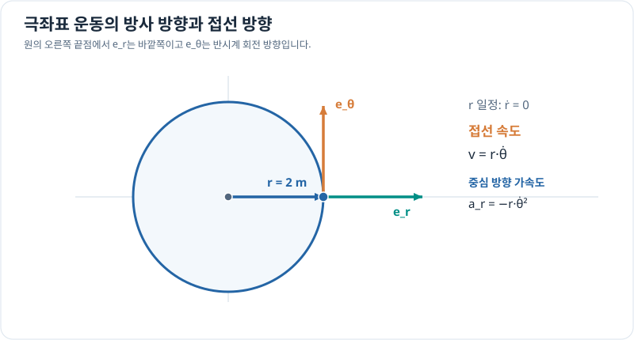

# 극좌표에서의 운동: 반지름과 각도가 변할 때

> 벡터와 좌표계 5/7 · 약 30~40분 · 선수 지식: [직교·극좌표 변환](coordinate-conversion.md), 미분법

## 위치가 두 가지 방법으로 변한다

극좌표에서는 시간이 흐를 때 반지름 $r(t)$과 각도 $\theta(t)$가 각각 변할 수 있습니다. 위치벡터는

\[
\mathbf r(t)=r(t)(\cos\theta(t),\sin\theta(t)).
\]

단위벡터를 다음처럼 정의합니다.

\[
\mathbf e_r=(\cos\theta,\sin\theta),\qquad
\mathbf e_\theta=(-\sin\theta,\cos\theta).
\]

$\mathbf e_r$는 **바깥쪽**, $\mathbf e_\theta$는 각도가 증가하는 방향의 **접선**을 가리킵니다. 둘은 서로 수직이고 길이가 1입니다.

## 그림으로 이해하기

*원에서 오른쪽 끝점에 있을 때 방사 방향은 오른쪽, 양의 각도 변화에 따른 접선 방향은 위쪽입니다. 위치가 일정한 반지름에서 움직여도 속도 방향은 달라집니다.*

## 속도를 미분으로 유도하기

각 단위벡터도 $\theta(t)$에 따라 방향이 변합니다. 연쇄법칙으로

\[
\frac{d\mathbf e_r}{dt}=\dot\theta\,\mathbf e_\theta
\]

를 얻으므로, 위치벡터를 미분하면

\[
\boxed{\mathbf v=\dot r\,\mathbf e_r+r\dot\theta\,\mathbf e_\theta}.
\]

$\dot r$은 반지름의 시간 변화율(m/s), $\dot\theta$는 각속도(rad/s)입니다. **속도의 접선 성분**은 $r\dot\theta$이고, 전체 속력은 $\sqrt{\dot r^2+(r\dot\theta)^2}$입니다.

한 번 더 미분하면 가속도는 다음과 같습니다. 이 식은 앞으로 운동학·동역학 학습에서 다시 다루어도 됩니다.

\[
\mathbf a=(\ddot r-r\dot\theta^2)\mathbf e_r+
(r\ddot\theta+2\dot r\dot\theta)\mathbf e_\theta.
\]

## 문제 예시: 일정 반지름의 원운동

가상 물체가 반지름 $r=2$ m의 원을 각속도 $\dot\theta=\pi/2$ rad/s로 일정하게 회전합니다. 속력과 가속도 크기를 구해 보세요.

**풀이.** 반지름이 일정하므로 $\dot r=\ddot r=0$이며 각속도가 일정하므로 $\ddot\theta=0$입니다.

\[
\|\mathbf v\|=r|\dot\theta|
=2\cdot\frac\pi2=\pi\,\mathrm{m/s}.
\]

가속도는 방사 방향의 음의 값(중심 방향)만 남습니다.

\[
\mathbf a=-r\dot\theta^2\mathbf e_r,\qquad
\|\mathbf a\|=2\left(\frac\pi2\right)^2
=\frac{\pi^2}{2}\,\mathrm{m/s^2}.
\]

**속력이 일정해도 방향이 바뀌므로 가속도는 0이 아닙니다.**

## 확인 문제

$r=3$ m에서 반지름 변화가 없고 $\dot\theta=2$ rad/s일 때 속력은 얼마일까요?

## 확인 문제 풀이

$v=r|\dot\theta|=3\cdot2=6$ m/s입니다.

**다음:** [3차원 직교좌표계](cartesian-3d.md) · [이전](coordinate-conversion.md)
