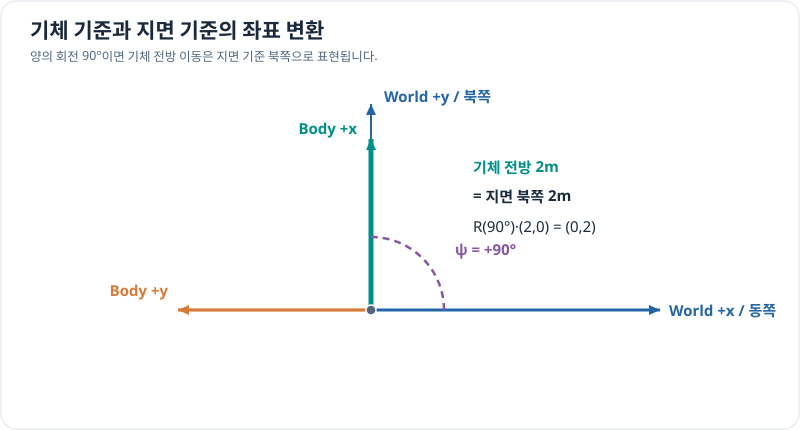

# 기준 좌표계와 회전: 지면 기준과 기체 기준

> 벡터와 좌표계 7/7 · 약 30~40분 · 선수 지식: [3차원 직교좌표계](cartesian-3d.md)

## 동일한 이동이 서로 다른 좌표를 가질까?

드론이 '앞으로 2m' 이동한다는 말은 **기체의 앞쪽**을 뜻할 수 있습니다. 기체가 바라보는 방향이 바뀌면 지면에서의 이동 방향도 바뀝니다.

- **지면 고정 좌표계(World/Local frame):** 고정된 기준축을 사용합니다.
- **기체 고정 좌표계(Body frame):** 기체의 앞·옆 방향을 축으로 사용하며, 기체가 회전하면 함께 회전합니다.

두 기준의 축 방향과 원점, 오른손 좌표계 여부, 각도 양의 방향을 먼저 정해야 합니다.

## 그림으로 이해하기

*예시에서 지면의 +x는 동쪽, +y는 북쪽이고, 기체의 +x는 전방입니다. 기체가 동쪽 기준 반시계로 90° 돌아서면 기체 전방 2m는 지면에서 북쪽 2m입니다.*

## 2차원 회전행렬

이 단원에서 정한 **반시계 방향을 양수**로 두고, 기체 성분을 지면 성분으로 변환하는 2차원 회전행렬을 다음과 같이 정의합니다.

\[
\boxed{
\begin{bmatrix}x_w\\y_w\end{bmatrix}
=
\begin{bmatrix}
\cos\psi&-\sin\psi\\
\sin\psi&\cos\psi
\end{bmatrix}
\begin{bmatrix}x_b\\y_b\end{bmatrix}
}
\]

여기서 $\psi$는 지면 +x축에서 기체 +x축을 향해 반시계 방향으로 잰 각도입니다. **방향 벡터의 변환**은 회전만 필요하지만, 서로 다른 원점에서 표현한 **위치**를 변환하려면 원점 사이 이동량도 더해야 합니다.

회전행렬의 역행렬은 전치행렬이며, 반대 방향의 좌표 변환에는 $R(-\psi)=R(\psi)^\mathsf T$를 사용합니다.

## 문제 예시: 기체 전방 이동을 지면 좌표로 바꾸기

기체가 지면 +x축에서 $\psi=90^\circ$ 반시계로 돌아서 있다고 가정합니다. 기체 기준 변위가 $(2,0)$ m일 때 지면 기준 변위를 구해 보세요.

**풀이.** $\cos90^\circ=0$, $\sin90^\circ=1$이므로

\[
\begin{bmatrix}x_w\\y_w\end{bmatrix}
=
\begin{bmatrix}0&-1\\1&0\end{bmatrix}
\begin{bmatrix}2\\0\end{bmatrix}
=
\begin{bmatrix}0\\2\end{bmatrix}\,\mathrm m.
\]

기체 기준 '앞으로 2m'가 지면에서는 '북쪽 2m'가 됩니다. 회전 후에도 벡터의 길이는 2m로 보존됩니다.

## 실제 3차원 좌표계로 확장하기

3차원에서는 Roll·Pitch·Yaw나 회전행렬을 사용하지만, **축의 정의와 회전 적용 순서에 따라 식과 부호가 달라질 수 있습니다.** ENU/NED 또는 기체축의 구체적인 약속을 명시하지 않고 2차원 회전 공식을 그대로 3차원에 적용하지 않습니다. 상세 내용은 선형대수학·동역학·제어공학에서 연결합니다.

## 확인 문제

위와 같은 2차원 약속에서 $\psi=180^\circ$로 회전한 기체의 전방 변위 $(1,0)$ m는 지면 좌표로 얼마일까요?

## 확인 문제 풀이

\[
R(180^\circ)(1,0)^\mathsf T=(-1,0)^\mathsf T\,\mathrm m.
\]

기체 앞쪽은 이 경우 지면에서 서쪽입니다.

**이전:** [3차원 직교좌표계](cartesian-3d.md) · [단원 목차](index.md)

**후속 연결:** 선형대수학의 벡터·행렬, 다변수 미적분학의 좌표 변환, 동역학의 회전 운동.
