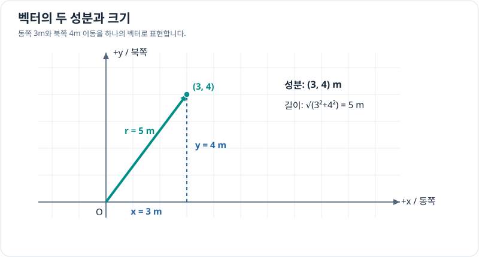

# 벡터와 성분 분해

> 벡터와 좌표계 1/7 · 약 30~40분 · 선수 지식: 피타고라스 정리와 삼각함수

## 크기와 방향을 함께 표현하기

'5m 이동했다'는 이동한 길이만 알려줍니다. 크기만 표현하면 **스칼라**, 크기와 방향을 함께 표현하면 **벡터**라고 부릅니다.

평면 벡터 $\mathbf v=(v_x,v_y)$의 크기는

\[
\|\mathbf v\|=\sqrt{v_x^2+v_y^2}
\]

입니다. 동쪽을 $+x$, 북쪽을 $+y$로 정하면 동쪽 3m, 북쪽 4m 이동은 $\mathbf d=(3,4)$ m이고 크기는 5m입니다.

## 그림으로 이해하기

*벡터의 직교 성분으로 직각삼각형을 만들 수 있습니다. 각 성분의 부호는 방향, 벡터의 크기는 길이를 의미합니다.*

기준축에서 반시계 방향으로 잰 각도가 $\theta$이면

\[
v_x=\|\mathbf v\|\cos\theta,\qquad
v_y=\|\mathbf v\|\sin\theta.
\]

0이 아닌 벡터를 크기로 나누면 방향만 나타내는 **단위벡터**가 됩니다.

\[
\hat{\mathbf v}=\frac{\mathbf v}{\|\mathbf v\|}.
\]

## 문제 예시: 두 지점 사이의 변위 벡터

지도에서 시작점이 $P=(2,1)$ m, 도착점이 $Q=(-1,5)$ m입니다. 변위, 크기, 단위벡터를 구해 보세요.

**풀이.** 변위는 도착점에서 시작점을 뺍니다.

\[
\Delta\mathbf r=Q-P=(-3,4)\,\mathrm m.
\]

크기는 $\sqrt{(-3)^2+4^2}=5$ m이고, 단위벡터는 $(-3/5,4/5)$입니다. 즉 서쪽 3m·북쪽 4m 방향입니다. **벡터 성분은 음수일 수 있지만 벡터의 크기는 음수가 아닙니다.**

## 확인 문제

벡터 $\mathbf v=(6,8)$ m의 크기와 단위벡터를 구해 보세요.

## 확인 문제 풀이

\[
\|\mathbf v\|=\sqrt{6^2+8^2}=10\,\mathrm m,\qquad
\hat{\mathbf v}=(0.6,0.8).
\]

단위벡터의 크기가 1인지 검산할 수 있습니다.

**다음:** [2차원 직교좌표계](cartesian-plane.md) · [단원 목차](index.md)
