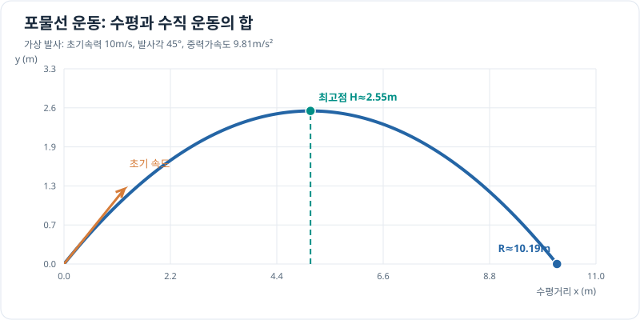

# 포물선 운동

초기 속도로 던진 물체가 중력만 받을 때의 궤적을 살펴봅니다. 수평 방향의 운동과 수직 방향의 운동을 나누어 생각하면 위치를 계산할 수 있습니다.

## 그래프로 이해하기

*설명용 가상 발사 예시입니다. 본문의 일반식에 v₀=10m/s, θ=45°, g=9.81m/s²을 넣으면 최고점은 약 2.55m, 사거리는 약 10.19m입니다.*

## 가정과 변수

- 물체를 지면의 원점 \((0, 0)\)에서 발사합니다.
- 공기 저항을 무시하고 중력가속도 \(g = 9.81\,\mathrm{m/s^2}\)를 일정하게 둡니다.
- \(v_0\): 초기 속력 \(\mathrm{m/s}\)
- \(\theta\): 수평면을 기준으로 한 발사 각도
- \(t\): 발사 후 시간 \(\mathrm{s}\)

## 운동 방정식

초기 속도를 수평 성분 \(v_0\cos\theta\)와 수직 성분 \(v_0\sin\theta\)로 나눕니다. 수평 가속도는 0이고 수직 가속도는 \(-g\)이므로, 각 성분을 시간에 따라 적분하면 위치는 다음과 같습니다.

\[
x(t) = v_0\cos\theta\,t
\]

\[
y(t) = v_0\sin\theta\,t - \frac{1}{2}gt^2
\]

물체가 출발 높이로 돌아올 때 \(y(t)=0\)입니다. \(t=0\)을 제외한 비행 시간과 수평 도달 거리는 다음과 같습니다.

\[
T = \frac{2v_0\sin\theta}{g}, \qquad
R = v_0\cos\theta\,T = \frac{v_0^2\sin(2\theta)}{g}
\]

수직 속도가 0이 되는 시점 \(t=v_0\sin\theta/g\)의 최고 높이는 다음과 같습니다.

\[
H = \frac{v_0^2\sin^2\theta}{2g}
\]

## 시뮬레이션

초기 속력과 각도를 바꿔 궤적, 비행 시간, 최고 높이, 수평 도달 거리를 비교해 보세요.
축은 고정된 거리·높이 범위를 사용합니다. 회색 점선은 20 m/s, 45°의 기준 궤적이고, 파란 곡선은 현재 설정의 궤적입니다. 파란 곡선 위에 마우스를 올리면 해당 지점의 x, y 좌표를 볼 수 있습니다. 초기화 버튼은 처음 입력값과 결과로 되돌립니다.

<iframe src="../../simulations/projectile/index.html?v=reset-3" title="포물선 운동 시뮬레이터" width="100%" height="640" loading="lazy" style="border: 1px solid #ddd; border-radius: 8px;"></iframe>

<a href="../../simulations/projectile/index.html?v=reset-3" target="_blank" rel="noopener">시뮬레이터 새 창에서 열기</a> · [Python 원본 코드](https://github.com/koosco/applied-science/blob/main/simulations/projectile_motion.py)

## 확인할 점

1. 같은 속력에서 각도가 커지면 최고 높이는 어떻게 달라지나요?
2. 각도가 45°일 때 수평 도달 거리가 최대가 되는 이유는 무엇인가요?
3. 초기 속력을 두 배로 하면 비행 시간, 최고 높이, 수평 도달 거리는 각각 몇 배가 되나요?

이 결과는 공기 저항이 없는 이상적인 모델에서만 성립합니다. 실제 물체는 공기 저항과 바람 등의 영향을 받습니다.
